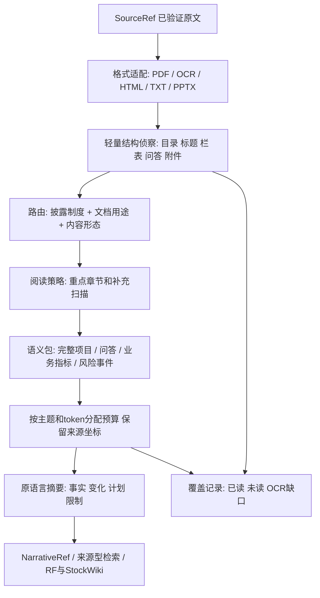

# 文档类型与章节驱动的文档理解

## 1. 决策

升级现有单体内的解析/选择层，使用**共享规范化表示＋可组合文档策略＋语义完整的证据包**。不为每种文档复制一套 PDF→MD→切片流水线，不增加微服务、向量库、任务库或逐文档 agent。确定性路由/结构/预算用代码，少量版本化策略用数据，现有配置 LLM 只处理精选上下文。skill 如需提供，作为一个薄调用说明；不另建十几个各自拥有选择逻辑的 skill。

已有 SourceRef/SourceExport v2、原文回放、格式解析、AUTO Store、有限并发、成本恢复均保留。新增层不打开公司目录，不复验证券身份，不收集签收 JSON。只有读取责任层打开/验真原文，来源层负责身份/期间/as-of；文档策略消费结果。

## 2. 证据说明为什么值得做

本轮抽取20份原件的原生文本，在重点页/段落阅读并目视核查4页，另调用现有 parser0.1.1/selector0.8.0 做3份原件回放。详细数据在本目录压缩证据，不能把扫描页数等同于逐页人工精读。

1. 标题规则把鼎龙“对招股说明书的确认意见”当prospectus；一页扫描确认函不是招股正文。它原生文本为空，自动流程仍需要有限OCR才可判断，不因标题或空结果立即丢弃。
2. 恒锋“向特定对象发行A股股票募集说明书”没有匹配目前“发行股票”正则，unknown落到96 span。已知kind改为equity后，候选449→478；96 cap的重点4页选中数4→0；增加到160也只回到4。建设期在三种对照里仍没选中。只修标题或调预算不能解决结构和候选竞争。
3. 名创2024港股年报p12中英双栏、门店网络表、TOP TOY扩展说明全部未进入本次96条精选。该页同时有跨年/区域/经营模式店数，属于业务驱动，不应按“数字多”排除。其他页可能复述部分事实，本轮没有声称全文完全没有这些事实。
4. 中微2026Q1 p2–3包含详细产品/验证进展；世华同季10页多为财务表格，其他提醒事项“不适用”。不能把A股季报整体跳过，也不能强求每份季报都生成摘要。
5. 中微年报259页、半年报210页，IPO429页；港股名创IPO675页，融资/行业/业务信息跨多个远距离章节。固定“前若干页＋关键词”会漏读。
6. IR问题跨页，管理层回答可否定问题前提；TXT同时有编辑摘要、参与人列表、管理层发言和分析师问题。必须保留来源角色、问答绑定、否定与语态。

目前 DocumentStructure 是扁平 units；`narrative_context` 的章节加分按页重置，只覆盖少量IPO/融资情形；选择链上逐步叠加关键词、邻居、项目和业务分组。W04已改善整句原子性，应保存其正确行为，再用章节/语义对象统一编排这些规则。

## 3. 新流水线

轻量侦察先扫描标题、目录、页块等结构；仅对优先页进行昂贵表格识别/OCR、上下文恢复和模型摘要。原生文本的线性轻扫通常便宜，本轮2390页原生扫描不意味着可以省略OCR页。预算用完就记录 deferred，不将缺口变成“没有业务内容”。不强制只读全文5%或10%，招股/募资全文业务占比可能很高。

## 4. 分类轴和路由

一份DocumentProfile包括regime、family、purpose、carrier、language lanes、revision。市场/上市地不是唯一决定因素：港股/美股双重上市公司可同时有20-F、HK年报、6-K附件，分别按披露形式和内容处理；行业作为可选提示，先通用支持零售、软件、制造，不堆公司特例。

- regime: cn_exchange / hkex / sec / other / unknown。
- family: annual / interim / quarterly / prospectus / offering / results_release / presentation / investor_qa / earnings_call / administrative / unknown。
- purpose/subtype: IPO、增发、可转债、募资可行性、正式全文、摘要、修订、确认函、通知等。
- carrier与语言属于正交轴；PDF英文标题不等于US，文件目录不决定类型。

元数据/SEC form和实际封面/目录/章节证据优先，文件标题作提示；冲突给alternatives和reason，未知走保守通用阅读，不新增“人工先签收”门。标题含“年报”也可能是独董述职，含“招股说明书”也可能是确认函。行政用途只是候选，必须通过可读正文核实后才能skip。

8-K/6-K/汇编文件允许父文件和局部子文档策略；同原件内部用unit区间路由，附件是既有SourceRef则传链接，缺附件返回needs_source让FF已有流程处理。路由器禁止下载附件或把链接当已读全文。修改稿不覆盖原始版本，证据固定来源版本。

## 5. 类型阅读矩阵

| 文档 | 优先读什么 | 语义切片/摘要重点 | 必须避开的错误 |
|---|---|---|---|
| A股年报 | 管理层讨论、业务概要、行业、研发、经营变化、未来计划，补重要事项/业务相关附注 | 产品/客户/订单/产能/出海事件包；总结报告期变化与未来计划 | 忽略财务章节中的经营驱动；把摘要/独董述职当完整年报 |
| A股半年报 | MD&A、上半年变化、项目进度、下半年安排 | 相同业务主体可对比历史，但保留本次独立证据；未披露不等于停止 | 直接复用年报摘要；把半年累计写成季度 |
| A股季报 | 重要内容、变动原因、其他提醒事项、短业务叙述 | 稀疏扫描后按事实选择；可完整检查后标低业务密度不调LLM | 整类跳过；把归母利润变动原因当产品进展 |
| 港股年报/中期 | Business Review/業務回顧、主席/CEO陈述、MD&A、Outlook、期后事项 | 双语分别恢复阅读顺序；选原语言一份并保留另一语言对应链接；店数/用户/订单表有价值 | 双栏串读、同一事实中英重复；期后事件写成报告期内 |
| SEC10-K | Item1 Business、1A业务风险、7 MD&A；有选择地读分部/合同/并购附注 | 业务分部、商业机制、消费/订阅/KPI、具体变化；HTML直接使用DOM | 把目录/交叉引用当正文；套20-F编号；丢失有业务意义的notes |
| SEC10-Q | Part I Item2 MD&A、业务附注、PartII风险更新 | 本季度与YTD分开；承接但不复制10-K背景 | 当成A股常见短季报；同/环比或GAAP/nonGAAP混淆 |
| SEC20-F | Item4公司/业务、Item5经营回顾、Item3D风险 | 监管/公司结构对业务的事实约束、业务与产品变化 | 用10-K章节编号；按上市市场猜国家/币种 |
| 招股书（A/H/US） | Business/业务与技术、Industry、竞争、客户供应商、增长策略、用途和具体风险 | 建“业务基础知识＋发行当时事实”包；产品/收入机制/市场口径/客户依赖/扩产逻辑 | 只抓最新事件；把2019计划写成2026现状；外部行业统计当公司实际业绩 |
| 增发/可转债/募资可行性 | 募投用途、必要性、项目投资/产能/时间/许可/消化安排、现有业务与风险 | 按项目绑定产品/主体/地点/投入/新增vs总产能/建设与爬坡/前提；补流单列 | 将投资额、项目测算收入当实际收入；债券条款耗尽预算；只读标题含“招股” |
| IR调研/业绩说明会 | 问答、管理层补充、数字与否定、具体进度 | Q+A及追问组成单元；区分提问推测/答复事实/避而不答 | 把问题中的客户合作当已发生；套话最多只能降权不能删回答的否定 |
| 电话会TXT/HTML | 管理层prepared remarks、展望、分析师Q&A | 发言轮次/角色＋主题；原语言；编辑摘要与真实发言分开 | 把分析师问题或网站takeaways当管理层原话；不经角色识别重复摘要 |
| 业绩发布/演示稿 | Highlights、业务分部、经营指标、图表脚注 | 一个slide/图/指标说明构成包；单位/时间/同比口径随包 | 空白提取当无内容；图表失读却宣称完整 |
| 行政/一般格式材料 | 封面＋正文确认用途；混合内容做补充探测 | 确認无业务后skip派生，原件/来源保留 | 仅标题判跳过；财报正文中混入行政附件连带全部丢弃 |

研报/新闻/政策用通用source-oriented策略，保留第三方作者/事实/观点属性；不把研究机构预测写成公司披露。首轮不扩大到正式投资报告生成。

## 6. 结构与证据表示

沿用稳定NarrativeUnit/EvidenceSpan作为来源锚点；加临时SectionIndex和SemanticUnit视图，用unit_id/locator引用原文，不重写locator、不产生第二份全文。

- SectionIndex: 父子章节、正文起止unit、heading层级、语言/栏、角色、构造依据和不确定性；区分目录、页眉、正文重复标题；跨页延续到下一同/高层标题。
- SemanticUnit: paragraph_event / qa_exchange / project / operating_table / risk / background。包含引用的units及table_header/footnote/question/answer/continuation等关系，必要的限定语随证据保留。
- 跨页、跨表头与多问题/多回答允许多对多引用，成员去重；不是把整个章节塞成一个巨大原子包。长项目可分属性包，但每包带项目主体和条件；超过硬预算返回deferred，不能截一半伪称完整。
- 表格按语义判别：三表/常规账龄优先忽略；门店/产能/认证/在研进度/订单/交付/用户/留存/每店产出保留必要行列、单位、期间和脚注。不靠“有两个数字”判财务。
- 双语对齐只做有证据的对应，保持原语言。匹配不充分就保留独立/uncertain，不用翻译生成新证据。用户语言偏好选择已有语言；不翻译原文。

## 7. 摘要与变化提取

共用摘要schema/验证器，profile提供关注点与输出优先级。输出面向来源：已发生事实、报告期变化、经营机制、公司计划、业务限制/具体风险、关键未披露项；没有来源支持不生成。摘要各claim回指精选SemanticUnit及原EvidenceSpan。

涉及数字保留概念/单位/币种/期间/地域/合并范围/实际或预测；例如门店总数不等于净新增、GMV不等于收入、项目capex不等于项目收益、订单不等于收入。已有deterministic数字/角色校验复用；大节点的独立语义审查检验是否真蕴含，不能以引用存在代替事实正确。

跨报告变化只在同主体、同口径、不同日期且证据齐全时生成可复核delta；本轮先把单文档做对。变化服务由ROOT在后续增量步接入既有NarrativeRef检索，不构建第二研究状态库。无上期资料则标not_compared，缺披露不当零。历史招股书作为background检索时始终带历史日期。

## 8. 性能、空间与并发

- 原件一份，派生只保留精选引用/摘要、紧凑章节区间/覆盖诊断和恢复usage；不落地整篇MD/完整DOM/所有span/截图。
- 扫描/结构/选择尽可能同一次parse内存传递；读取责任层一次SHA验真，当前source版本提交时按既有逻辑复核。profiles/structure不重hash文件。
- 缓存身份要含source版本、parser、structure/profile/selector/prompt、模型实际spec和language；同版本复用0HTTP，变化仅失效受影响文档，禁止全库重建。
- 继续现有AUTO leases/generation/outbox、子进程隔离客户端、模型和解析分别有界。按大/小文档和OCR成本排队可改善吞吐；不无限并发，不增加第二数据库。
- 初始工程目标（待A节点冻结）：新增持久结构sidecar常规≤64KiB/文档（大文档可流式压缩并受批次上限约束）、代表样本新增派生总量不高于当前基线；p95处理耗时不超过基线1.25倍，目标减少昂贵表格/OCR与无价值LLM调用。超过目标解释真实收益，不能删有效业务信息凑体积。
- 不能凭20样本承诺节省X%或解释全部当前磁盘占用；这里优化未来派生增量，绝不删除原始PDF。准确节省量在真实批次前后按raw/derived/scratch/db分别计量。

## 9. 设计范式与迁移

从“扁平文本上叠关键词规则”转向“类似编译器的分阶段管线”：格式前端→共享结构→文档策略→语义证据→摘要输出。各阶段纯函数优先，IO和调度留在现有边界。无需大型插件框架，静态profile注册即可。

ROOT先适配现有units到冻结输入，整合两包纯函数，再把现有分组/阶段/否定规则接到SemanticUnit内，合并重复邻居推断。只在开发基准中对照旧版；新生产默认通过大节点后一次切换，不重新设canary人工许可。历史NarrativeRef按历史parser回放；移除已被新路径取代的运行规则/未使用旧prompts入口需依赖检查，不能删仍需历史回放的实现。

## 10. 尚待验证

本轮尚未读真实US S-1/F-1、完整8-K/6-K附件容器及修订稿对；需要DU-BENCH补真实样本或诚实标缺。英中语义对齐不能仅靠词相似；经营表格召回、跨页完整性、真实LLM成本/摘要忠实度都必须在C节点验证。扫描确认函只目视核查，未跑OCR；不可据此认证OCR路由已好。

官方结构参考仅用于策略依据，不替代原文：

- SEC [10-K阅读说明](https://www.sec.gov/files/reada10k.pdf)（历史投资者指南，仅引用Business/MD&A等稳定概念，不把旧Item6列表当现行全量schema）；[10-Q表格](https://www.sec.gov/files/form10-q.pdf)、[20-F表格](https://www.sec.gov/files/form20-f.pdf)。
- HKEX [Annual Report Explorer](https://are.hkex.com.hk/home/en)及[年报编制指南](https://en-rules.hkex.com.hk/sites/default/files/pdf_documents/Guide_on_Preparation_of_Annual_Report_e_202512-1.pdf)搜索摘要提示业务模式/行业因素/KPI；指南本体工具打开失败，不据此声称已全文核验。
- CSRC [发行类第4号](https://www.csrc.gov.cn/csrc/c101802/c7118238/content.shtml)关于募资与业务适配、[研发披露说明](https://www.csrc.gov.cn/csrc/c101802/c7445462/content.shtml)关于业务与技术/研发口径。仅作格式研究，不作法律意见。
