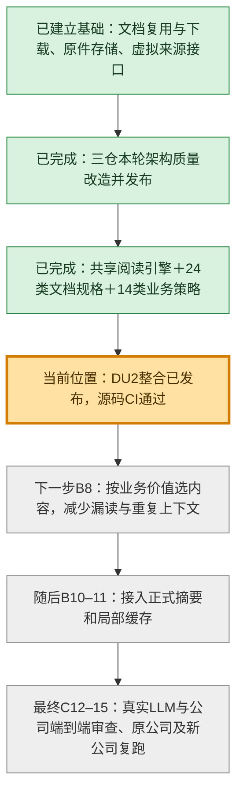

# 项目当前位置 — 2026-10-13

**DU2 三包与共享引擎整合已验收、并入 master、推送，精确源码 CI 通过。整个 PWF 尚未完成。**

## 用大白话说

以前更接近“抽出文字、按规则选一些段落”。现在共享模块已经能按文档类型识别章节范围，给不同业务配置阅读重点，并把选中内容需要的表头、脚注、否定及限定条件一起送入摘要输入。没有为每种文档另造一套引擎。

这轮证明了模块真的被消费、材料能回到原文、预算和缺口报告可靠；还没有证明正式生产摘要和收入预测全流程已达到研究质量。

| 部分 | 已验证到哪里 | 还需要做什么 |
|---|---|---|
| 采集、原件与虚拟来源接口 | 已有基础，消费者使用版本化来源引用 | 新阅读链仍需正式接线及整条真实路径验收 |
| 本轮 CWP/FF/RF 架构质量改造 | 已发布，各自精确 CI 通过 | 不据此声称全项目无硬编码或所有研究质量达标 |
| 文档阅读策略 | 唯一运行目录含24文档规格、14业务策略；层级与实际范围进入共享模块 | 继续优化选择器的业务价值、主题多样性和共享上下文成本 |
| PDF版面 | 既有粗文字框、页尺寸和字体进入有界布局模块 | 四样本细列/单元格关系未可靠恢复，仍标partial |
| 正式模型摘要与缓存 | 公共模块验收完成，生产默认尚未切换 | B10–11：正式消费者、相关策略局部失效、复用0POST |
| 公司预测与独立审查 | 旧微软关键业务baseline仍4/8 FAIL | C12–15/G2/G4/G5真实模型、原公司修复及新公司泛化 |

本轮证据：联合1135 PASS；四份PDF的658处最终原文片段回放通过；真实10-Q六项检查通过；正常推送测试4175 PASS/17 SKIP；[精确源码 CI](https://github.com/zhengcb81/company-wiki/actions/runs/38476678472) success。

原始文档和生产配置未修改；没有新增逐材料授权、canary或人工签收许可。本轮没有模型调用或费用。现有原件验证与资源上限继续由负责层执行。

实施顺序及边界：[task_plan.md](task_plan.md)、[验收报告](acceptance.md)、[发布收据](evidence/publication.json)。
