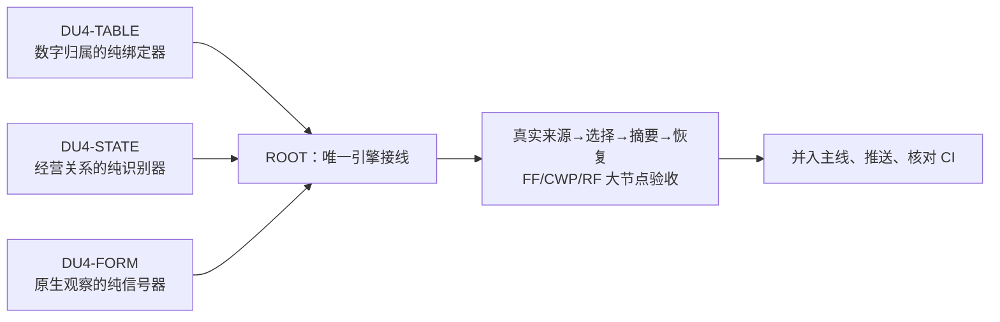

# DU4：三个可同时开工的独立施工包

2026-10-15。ROOT 负责主线，三个作者分别实现新的纯组件。三者不等待彼此，不修改相同文件。**组件完成不等于生产接线完成**；ROOT 接收后接入唯一共享引擎、做真实端到端验收，再正常并线发布。

| 施工包 | 独立工作目录 | 作者分支 | 卡 |
|---|---|---|---|
| DU4-TABLE：表格数字、列、期间与单位绑定 | `C:/Users/郑曾波/Projects/company-wiki-du4-table` | `codex/du4-table-20261015` | [施工卡](du4_table_measurements.md) |
| DU4-STATE：经营状态、否定与合作阶段 | `C:/Users/郑曾波/Projects/company-wiki-du4-state` | `codex/du4-state-20261015` | [施工卡](du4_operating_states.md) |
| DU4-FORM：真实表单与发言轮次信号 | `C:/Users/郑曾波/Projects/company-wiki-du4-form` | `codex/du4-form-20261015` | [施工卡](du4_source_signals.md) |

每个工作目录的入口均为 `docs/plans/du4-{table|state|form}-2026-10-15/task_plan.md`。其中已有本卡、公共接口、自己的真实观察夹具和参考设计副本。向 harness 提供工作目录和该入口即可。不要在主目录或另外两个目录施工。

三个工作目录从已提交 `8206e78d4087531b1d7ed57c45a73c942cc702e3` 出发，稀疏检出 src/scripts/tests/tools 与根工程文件，共享 Git 对象，不复制 companies、sectors、生产 config、AUTO、缓存和原始财报。初始源码逻辑大小约 15.2 MB/份；后续各自测试缓存需自行限额与清理。

## 分工和合流

ROOT 独占：所有既有共享源码的修改、normalizer/parser、router、selector、pipeline、canonical context/模型协议、generation/cache、预算/AUTO、RF/FF、默认切换、总 PWF、最终并线。ROOT 不在接收前修改三个作者新包。作者不得在既有源码加旁路接线，也不必为证明生产调用而越界；提交可执行的组件测试和清楚的接线建议即可。

## 统一质量和交接

遵守 [INTERFACES.md](INTERFACES.md)。仅 A（真实反例与 RED）、B（组件实现与集中测试）、C（交付）三个大节点留证，不增加人工审批、授权 JSON 或小步骤签收。

交付自己的 branch + commit，报告实际测试命令、通过/失败/未测、真实夹具与合成用例的区别、未接线范围。不得自己 merge/cherry-pick 到 master、同步安装技能或改别人工作目录。正常提交，保留 hooks；全库检查若发现本包以外问题，记录并交 ROOT 处理。

ROOT 接收顺序：核对文件边界及接口 → 每包集中测试 → FORM 原生采集/路由、STATE 单一谓词、TABLE 原生格槽与选择的接线 → 合并后的真实质量/兼容/恢复大节点 → 发布。接收可以错开，不要求三个包同时完成。

## 当前状态

- FORM：用户通知完成；四commit接入ROOT合并工作区，组件327集中PASS/独立11组探针PASS，ROOT已修复预算及不连续拼接共因，正常发布进行中。生产native/router/真实holdout尚未验收，见[接收细则](../../review/du4_form_acceptance.md)。
- TABLE/STATE：继续IN_PROGRESS，未收到用户完成通知，ROOT不修改作者目录。
- 主线另一个节点已实测：新摘要生产 7 E2E、历史恢复 6 E2E 均通过，0 外部供应商调用；这不是 DU4 的验收结果。
- 当前默认仍 0.8；三家真实摘要质量及默认切换继续开放，不能因组件测试绿直接宣布完成。
