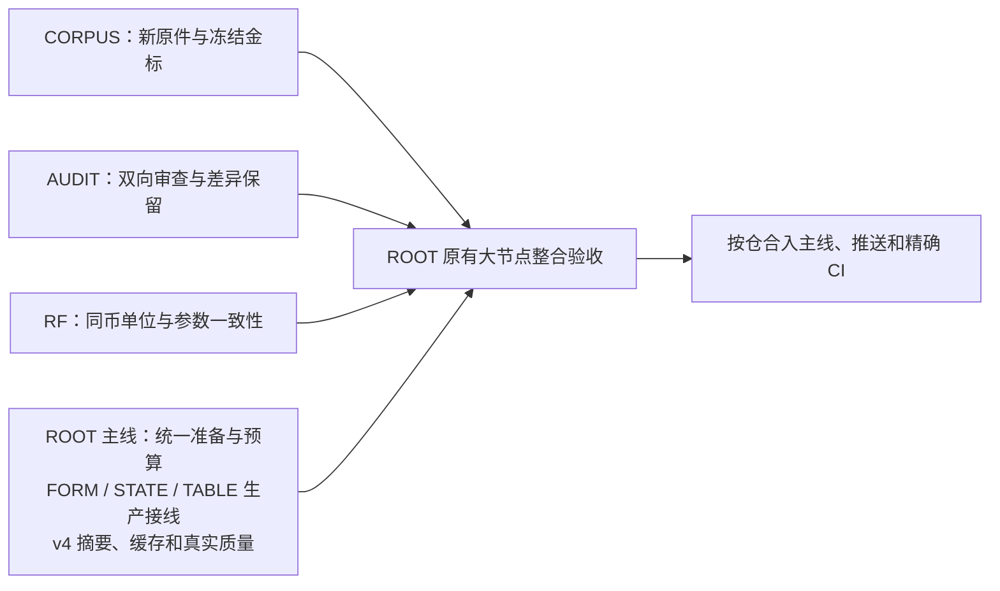

# 当前接收：2026-10-16

三作者已交付，不再是待启动任务。CORPUS/RF独审整改与集中验证通过、待正式发布；AUDIT接收修复中。以[ROOT接收细则](../../review/du5_reception.md)为准；下方READY是原发包记录。

---

# DU5：三条可同时启动的独立施工线

2026-10-15；ROOT 总调度。此次三张是新卡，DU4 三包已验收并线，不再派发。三个工作目录均已准备并核对为 READY；不能在旧 DU4 目录或仓库主目录直接施工。

|卡|工作目录|独占职责|入口|
|---|---|---|---|
|DU5-CORPUS|`C:/Users/郑曾波/Projects/company-wiki-du5-corpus`|现有 DU-BENCH 的真实新样本、独立金标、类型缺口与冻结对照；不改生产引擎|[施工卡](du5_real_document_corpus.md)|
|DU5-AUDIT-SUMMARY|`C:/Users/郑曾波/Projects/revenue-forecast-audit-du5-summary`|摘要双向独立审查包和同分母比较；不实现第二个语义评分器|[施工卡](du5_summary_semantic_review.md)|
|DU5-RF-UNITS|`C:/Users/郑曾波/Projects/revenue-forecast-du5-units`|RF 金额单位的单一描述表、HKD/CNY与同币缩放、真实参数单位核对|[施工卡](du5_money_units.md)|

各工作目录都有 `docs/plans/du5-{corpus|summary|units}-2026-10-15/task_plan.md`、本卡副本、`INTERFACES.md` 和独立 progress/findings。把对应工作目录和其中 task_plan.md 交给一个 harness，即可现在开始，不必等另外两条线或 ROOT 的 v4。

## 文件与接口所有权

- ROOT 保留 CWP `src/**`、parser/normalizer/router/selector/pipeline/WorkBudget、FORM/STATE/TABLE 接线、v4/model/runtime/worker/generation/cache、公开来源/reading context，以及总 PWF、FF 与最终真实供应商调用。
- CORPUS 独占 CWP `tools/document_understanding_benchmark/**` 和自己的 PWF。ROOT 在接收前只读该工具包；需要新生产观测时 ROOT 在自身接线测试内写观察，之后通过现有 `du-observed/1` 交入。作者不改生产代码以修复 baseline FAIL。
- AUDIT 只改卡中列出的 audit 仓文件。来源目标/审查结果是测试与审查声明，不是第二来源库；不依赖 CORPUS 的新金标才可运行。
- RF 只改卡中列出的 RF 单位责任层及其直接 consumer，不改 CWP reader、公开证据协议、FF 或 audit。ROOT 接收前冻结这份清单，不在同路径施工。
- 三作者不互相写文件、不合并 master、不同步安装副本；各自按卡提交分支。ROOT 核验与合流，无共享可变数据库和跨仓 writer。

## 接收与状态

共同交接见 [INTERFACES.md](INTERFACES.md)。只有 A（问题与 RED）、B（实施与集中回归）、C（端到端与交付）三个大节点，不增加小节点签收或人工许可。

当前状态：三卡 READY。三个独立工作区均干净，源码基线与5份启动PWF已正常提交，实际模块导入均指向本工作目录；仅做启动核对，尚未执行本卡业务测试。作者启动后仅更新自己的 PWF，不改本表。两项工程工具均不得把“记录完备/可打开/schema合法”当成语义质量通过；来源金标失败不通过修改 expected 洗绿。

ROOT 合流顺序：任一卡完成即可先接收；生产新候选冻结后，用 CORPUS 做原件→选择回放，用 AUDIT 做逐 claim 与重要遗漏审查，RF 单位卡进入原三/新三预测 E2E。三张组件交付不关闭母计划的生产接线、真实质量和公司审计循环。

## 启动留证

见 [launch.json](launch.json)：CORPUS seed 197d9149、AUDIT seed 45e7f154、RF seed 12560da9。三个工作树逻辑大小约24.56/1.02/4.32 MB，共约29.90 MB；共用Git对象，未复制原件、AUTO、凭证或主目录WIP。没有运行API或业务测试，不把启动核对写成施工完成。
