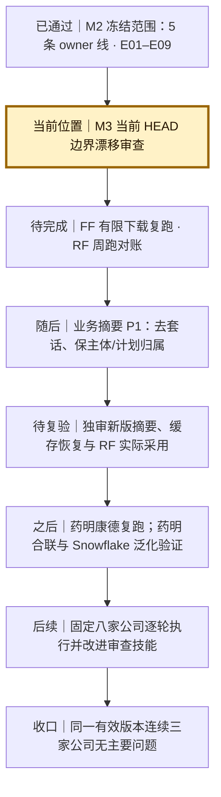

# 当前状态

本文件与 CURRENT_STATUS.json 记录现状，按 [task_plan.md](task_plan.md) 实施，复验见 [HANDOFF.md](HANDOFF.md)，长期循环见 [MAINLINE_LOOP_GOAL.md](MAINLINE_LOOP_GOAL.md)。

## 2026-11-20 W12 开始

原生目标已恢复为 `active`。药明康德 `w12-20261120-cn-603259` 已复用三份财报，首次执行新增下载为零。CWP 已正式生成并读回新版半年报摘要，同次与跨次恢复额外模型请求为零。RF 已采用一条 TIDES 业务依据，正式作业、报告、快照和 287 份证据已核对封存。四路独审完成 73 项，记录 22 项发现，其中 1 项 P1。专家已逐项归因，Audit 原生检查没有漏映射，工作进入六个责任包的整改阶段。当前优先补足两项主业远期收入的量级依据，CWP 和 Audit 在各自工区回归。 [W12 执行范围与交接](review/w12-wuxi-resume-20261120/README.md)

Audit W03 已独审通过并并入本地主线。已部署 `71381b5` 的技能到 `.agents` 和 `.claude`，两份安装均复验新进程入口和重复零写。本次作业采用从实际成功产物与当前执行身份推导。W12 未证日期的问答已写原 LOG，历史可得性检查继续执行。 [W12 接收记录](review/w12-wuxi-resume-20261120/README.md#w12-整改接收)

CWP 的本地 SQLite `#` 和 `%23` 路径问题已根修并经独审。CWP `/8` 的结构性语义修订已通过独审，正式回包、缓存和 RF 采用仍待验证。FF 离线配套已发布，药明精确 Q2 电话会仍是已查本地目录的缺项。RF 已用封存报告完成共同延期与取消的原生试算，独审发现不能只靠参数祖先证明是本业务未确认金额。继续补这项证明与主业远期量级依据。 [本轮复验边界](review/w12-wuxi-resume-20261120/README.md#w12-整改接收)

CWP `ccc09205` 的组合测试 171 项通过。远端发现测试观察器没有传递新增参数。该观察器已改为透传 owner 的全部可选关键字，正常宿主的 `/8` 环回通过。首次仅向测试服务请求一次，同次激活和跨次缓存均零重发。FF 已发布 `17e83b0` 的精确 CI 通过。 [CWP 原失败](https://github.com/zhengcb81/company-wiki/actions/runs/44740497857) · [FF CI](https://github.com/zhengcb81/filing-fetch/actions/runs/44739818531)

## 2026-11-20 反馈工程进展

F4 已由各仓独立 agent 完成 12 个本机模块上线和支持范围的验收。上线时 51 项组合回归通过，原反馈动作库字节一致。W12 接续的拒绝审视修复另有 53 项 Windows 宿主回归和 26 个独立探针通过。M6 已在原位置正式登记中微评估，Dashboard 本仓已公开读回。RF/Audit 的现场联合复验随可绑定的原作业接续。 [F4 分仓上线与范围](../feedback-loop-2026-11-17/f4-rollout.md)

Dashboard 长溯源和 StockQA 已付确认两项已验收发布。Dashboard 单页接收预算为 2 MB，浏览器完整读回 2,952,760 字节的 RF 注册图。StockQA 走 StockWiki 原生确认和 IQS 冻结验证，两个账本布局都能恢复同一已付结果，新增费用、请求和尝试均为零。各仓远端版本和复现方法已登记。业务接续仍按 W12 和后续公司样本。 [组合验收](../feedback-loop-2026-11-17/gate-closure-20261120.md)

## 2026-11-19 最新状态

F2 的 filing-fetch 短请求 `95769c0` 和 MeetingConverter 转录反馈 `1d3fd6c` 都已组合验收、发布。[工作目录与接续卡](../feedback-loop-2026-11-17/dispatch.md) · [FF 与 MC 组合](../feedback-loop-2026-11-17/f4-acceptance.md)

F4 已补验原生命令未启动的恢复，并覆盖责任仓已落回告、宿主回复丢失时的只读接续。[回告恢复复验](../feedback-loop-2026-11-17/f4-acceptance.md#5-责任仓已保存回告时的恢复)

MeetingConverter 已通过 `8b8e574` 接入本机 F4，实际完成自动分诊、发布清单修复、复验及持久回告。修复和回告强退后找回原作业，转录和翻译无新增。StockQA、StockWiki、IQS、Dashboard 已按正式交付顺序验收，三仓同一正式 V2 结果已通过 Dashboard HTTP 复验。[MC 运行验收](../feedback-loop-2026-11-17/f4-acceptance.md#8-mc-公开端口自动恢复发布清单) · [四卡交付](../feedback-loop-2026-11-17/progress.md#四张接续卡-root-验收)

公开入口的同协议版本、可选诊断和输出表示已做定向误拒审查。RF 原文及完整溯源、StockQA 作业决定、IQS 冻结清单的追加修复已验收。正反馈沿原分诊作业记录门禁的必要性、处置和证据，再由责任仓修复。 [门禁设计审查](../feedback-loop-2026-11-17/gate-design-review.md) · [拒绝审视协议](../feedback-loop-2026-11-17/interfaces.md#拒绝先审视门禁)

总控已验收 F4 两条无人值守闭环。CWP/FF 找回同一原文和作业。RF/Audit 在隔离宿主找回原作业和 capture，由 Audit 复验 RF 来源路由修复，并由 RF 读回回告。两条闭环都经过真实 Codex 同会话恢复，恢复无新增下载，旧费用未知仍保留。其余 owner 的生产接线开放。ET、SID、IR 首批三仓已发布。[CWP/FF](../feedback-loop-2026-11-17/f4-acceptance.md) · [RF/Audit](../feedback-loop-2026-11-17/f4-rf-audit-acceptance.md) · [F2 分仓路线](../feedback-loop-2026-11-17/f2-roadmap.md)

P1 的自动业务视图和真实缓存已在半年报、投资者关系样本通过。P2 的 RF 正式组合采用其中两条证据，计算及快照通过，原有 181 项参数值一致。F3c 用已保存响应修正范围漏检，自动精选移出单独的分红计算、模板陈述和财务背景，五份真实样本跨 A 股、港股、美股复验通过。下一步按 W12 和后续公司样本验证现版本的正式生成及 RF 采用。固定公司池继续依其原状态。[业务与采用实测](../feedback-loop-2026-11-17/f3b-live-acceptance.md) · [F3c 保存响应复验](../feedback-loop-2026-11-17/f3c-saved-response-acceptance.md)

## 2026-11-16 状态记录

- 九个主模块和四条独立依赖链已逐仓对账，实际 PWF 入口、当前版本、接口责任和余项见 [各模块计划入口与交接](../module-boundaries-2026-11-11/owner_plans.md)。StockWiki `b4ca912` 已在本仓接续三组 PWF，IQS 的计划和两份投影测试仍在活动分支，Dashboard 的本地文档进展已纳入对账。
- CWP `12e65fe7d` 将浏览请求状态与证明预算隔离，将候选和来源事实投影归目录 owner，将 CN 原生 PDF 读取归 parser adapter。原有 SourceRef、版本快照和错误信封通过定向回归和独立审查。代码已发布，固定推送快测 23/23，精确 SHA 的 GitHub CI 用时 4 分 42 秒且通过。 [CWP 浏览边界验收](../module-boundaries-2026-11-11/review/cwp-browse-owners-20261116.md)
- CWP 使用 FF `dd716217` 的公开入口补齐三市场有限下载离线证据。正向采集、零重复下载、V2 来源复用和损坏件拒读通过，测试目录已清理。 [有限下载离线验收](../module-boundaries-2026-11-11/review/ff-cwp-bounded-offline-20261116.md)
- **M3 已验收，当前进入 P1 业务摘要。** FF `4c7f501b` 正式 T3 四项通过，SID `fb8c8ba5` 已发布，RF `220e5441` 记录了旧周跑失败与原始版本。固定公司循环当前暂停。 [M3 证据](../module-boundaries-2026-11-11/review/m3-formal-t3-20261116.md)
- **P1 选中引用的展示已验收。** 半年报四张人工选定原文卡保留 12 项业务检查点，投资者关系旧产物的四类归属与限定反例通过，PDF 发言标签投影通过独审。下一步为自动精筛、正式新摘要和恢复。 [展示验收](review/p1-business-quote-view-20261116.md)

## 2026-11-15 状态记录（历史）

### 21:54 UTC update — shared-budget root fix published; exact-head CI green

最终 CWP 提交 `56d10f269b7c67845c7af66b33083f62d46cde4d` 已推送，远端 `master` 已复核为同一 SHA。提交钩子的 23 项固定快测通过（35.86 秒）；GitHub Actions run `43765642890` / job `132969996667` 在精确 SHA `56d10f2` 上通过，Python 3.12 全流程用时 7m13s；仅 1 条警告和 1 条 runner 迁移提示，无失败项。最终代码保持独立审查绑定的四个源/测试文件 SHA，62 项受影响契约测试通过；这次根修删除 CN 证明重复总字节计数器，并将 browse 级 `ReadBudget` 贯穿到现有验证 resolver。

另一项目的 StockWiki handoff `master@54f72c9` 记录过 CWP 本地候选 `7fd7f248d`（64→512MB）与当时的真实浏览结果。该记录是当时状态；CWP 最终主线 `56d10f2` 已用共享预算根因修复替代该候选，未改 StockWiki/RF/FF 文件。StockWiki 根计划已只读核对，无额外 ROOT 对齐任务。M3 仍只待 FF 的四个 T3 下载请求有限 `acquisition_limits` 与当前主线复跑收据，以及 RF 对 `20261115T084227Z / not-ok` 的 canonical PWF 记录和本地九提交/三项 assurance 改动对账；FF/RF 远端 refs 于 21:55 UTC 复核不变。固定公司循环仍暂停。

### 21:28 UTC update — read budget fixed; owner snapshot refreshed; CI binding corrected (superseded by 21:54 update)

CN proof 修复的根因与验证见下节。另纠正 CI 绑定：远端 `3e7b723` 的父链包含产品代码提交 `707efe814`，不是 `1391ae81` 的 PWF-only 后继；#537 只证明 `1391ae81`，不能外推到当前远端。当前本地 `master@7fd7f248` 含未推送的 512MB 中间提交，最终工作区已用共享预算修复替代，计划折叠为单一最终提交后推送并验 exact-head CI。

外仓只读状态刷新：FF `main@dd716217` 跟踪一致、tracked-clean；RF `main@be0caa4` 仍领先本地 `origin/main@f2215959` 9 个提交，`daily_alert.jsonl`、`weekly_alert.jsonl`、`weekly_manifest.json` 三个 tracked 文件有变动，weekly run `20261115T084227Z` 仍 not-ok 且未见于 canonical PWF；StockWiki `master@54f72c9` 无 remote、tracked-clean，根 `task_plan.md`/`progress.md` 已在 `5f79e7b`（17:30 UTC）更新，handoff 于 `54f72c9` 更新。用户说明外仓变化由另一项目并行推进；均未回退、清理或写入。M3 仍待 FF/RF 两项 owner 证据。

### 21:21 UTC update — CN issuer proof now uses the shared read budget

复核发现原有 CN issuer proof 另设 64 MB 总量阈值，和 SourceCatalog 的每请求 `ReadBudget` 脱节；改成 512 MB 常数只能掩盖问题。现在 `PublicCanonicalBrowser.browse()` 每次创建一份共享预算，并传入 `SourceVersionReader.open_described_version()`，由同一 resolver 按实际读取字节/候选数扣账；SHA、实际大小、每份 PDF 的 16 MB/1,000 页/800 万字符限制均保留。超过共享预算仍以无路径的 `cn_primary_proof_budget_exceeded` 返回。

TDD/验证：36 份、累计 126 MB 的行为回归通过；SourceVersionReader 真实 fixture 验证预算扣账与超限；受影响的两份契约测试 **62 passed / 171.67 秒，退出码 0**，临时目录 `removed=true`；Ruff、JSON 解析、`git diff --check` 通过。曾有一次同组 62 项均通过但 pytest 清理退出失败，根因是既有准入拒绝测试漏关第二个 SQLite catalog；已加 `finally` 并单条复验，完整重跑干净通过。独立边界审查 PASS，绑定四个文件哈希；指出 max_candidates 的 CN 浏览器最终 envelope 没有专门回归，该项非阻塞，保留为测试覆盖备注。代码与PWF尚待提交推送。

### 20:37 UTC update — CI closed; owner refs refreshed

CI 修复已在 exact SHA `1391ae81d8126b5026209e26ae56a7d9bb0a9f0c` 通过 GitHub CI #537（run `43757282611`）。唯一下一步仍是有限 M3 owner 对账：FF local/server `main@dd716217` 一致且 tracked-clean；FF PWF 已记载另一项 S3 BYD 有界下载 E2E 和 FF-1 合并，但这不等于 RF 周测四个失败下载请求已修复或复验——该周测请求漏传 `acquisition_limits`，当前主线 T3 复跑证据仍缺。RF local `main@be0caa4` 比 fresh live `origin/main@f2215959` 超前 9 个提交，两份 weekly assurance 跟踪文件有未提交修改；`20261115T084227Z` 仍为 not-ok，未见于 canonical PWF。StockWiki local `master@235ac72` 无 remote、tracked-clean；最近提交更新了三条 CWP 来源链接和 `SW-RESEARCH-PRODUCTION-01` 交接，但 root `task_plan.md` 仍需 owner 对齐。status 核对仅覆盖 tracked 文件，未枚举 untracked。外仓均保持只读。

以上 owner refs 仍是 20:37 UTC 的只读快照；其余外仓 owner 事项未变。CWP 的 64→512 MB 候选已被根因修复替代：删除重复常数，改用 SourceCatalog 统一请求预算；该工作区改动已通过定向测试与独审，等待发布。不要将此前“未审/未验收”的状态沿用到当前差异。

### 20:27 UTC update — exact-head CI passed

GitHub Actions CI #537 / run `43757282611` passed on the exact pushed SHA `1391ae81d8126b5026209e26ae56a7d9bb0a9f0c`; job `132944030549` completed in 7m52s. The job had one warning and one notice about upstream Node/runner migrations, and no failure annotations. This closes the current CI regression repair. The preceding `895f66f57` CI failure remains documented as the evidence that drove the follow-up. Next project work resumes at the finite M3 owner reconciliations below.

### 20:19 UTC update — reviewed CI follow-up pushed; exact run active

Follow-up commit `1391ae81d8126b5026209e26ae56a7d9bb0a9f0c` was pushed to `master`. The push hook's fixed smoke passed **23 tests in 14.31s**. GitHub Actions run `43757282611` / CI #537 later passed on that exact SHA (job `132944030549`, 7m52s); final result is recorded in the 20:27 UTC section above. This 20:19 note is the in-progress checkpoint.

### 20:11 UTC update — second CI run exposed two remaining test-scope mismatches

The first repair commit `895f66f57ce2346c8eb2102c9bd475a828b3e8c8` reached `origin/master`, but its exact run `43755195576` failed **4 instances**: one daily/fast-inventory contract assertion, plus three parameter cases of a Windows-only no-replace-rename test running on Linux. These were new test wiring/platform issues; no new product defect was indicated.

- The five unit regressions were added to `DAILY_PUSH_CASES` but not its parent fixed `FAST_CONTRACT_CASES` inventory. The invariant intentionally requires the daily set to be a strict subset. Added the same five IDs to the parent inventory; `CI_CONTRACT_CASES` continues to exclude unit nodes because GitHub's complete Unit phase owns them.
- The object-store fallback is correctly Windows-specific: on POSIX the production code propagates `PermissionError` rather than use a replace-capable `os.rename`. The old test asserted Windows behavior on every OS. It now runs only on Windows; a companion test injects the POSIX platform branch on any host and proves hard-link denial propagates without overwriting the racing object.

Validation after these fixes: the 13-file annotation-driven suite **500 passed** in 44.44s; daily push smoke **23 passed** in 19.72s; Ruff and `git diff --check` passed; the temporary test tree was cleaned. The new POSIX-branch test ran via a narrow OS adapter on this Windows host; the next Linux CI run will verify it under the real CI platform. Independent review of the code follow-up passed at baseline `895f66f57`, covering the inventory filter and Windows/POSIX test split. `895f66f57` remains the remote SHA with failing CI; follow-up publication and exact run are recorded in the 20:19 section above. Do not mark CI complete until the next exact-head run succeeds.

### 20:01 UTC update — CI regression roots fixed and pushed; exact-head run active

Run `43749426185`, job `132919838860`, failed in the full Unit suite. The anonymous Actions log endpoint returned 403, so this record is based on locally reproduced failures and the exact affected tests; no credentials were reused. Five underlying test/behavior areas were corrected:

- A joined source group used the later member's antecedent set as the whole-group default. Because that set included an earlier member of the same group, a valid joined reference was rejected. The owner now uses the first source-ordered member's predecessor window; a RED→GREEN regression covers the join.
- An eligible 80-row operating table was passed to the prose semantic-group path as one 79-member support set. Its prose-only member bound raised `ValueError`, which candidate selection turned into unresolved relevance despite available work budget. After table-purpose qualification and row/context filtering, the table path now retains its structural qualification; later fact and semantic admission checks remain in force. The 80-row regression now asserts complete assessment.
- The planned-PDF test patched the private reader but production planned scanning calls the public `pdf_text_blocks` alias. The test now observes both names; the PDF implementation did not need a production change.
- A work-budget fixture still used the pre-resource-observer 85×text estimate. The existing bounded negative route legitimately charges a second scan, so the fixture now uses 90× and still checks positive bounded work; no runtime budget was relaxed.
- The saved paid-response replay expectation omitted two current `possible_condition_scope_loss` diagnostics (c6 and c10). The test now expects those current decoder flags while preserving the archived public projection unchanged.

Pre-commit did not catch these because it intentionally runs static checks and not pytest. The old push smoke also omitted these regressions. The fixed daily push list now adds five exact tests (one representative of the shared planned-PDF alias path) to its existing 9 cases; it remains a fixed list with the existing 180-second cap and no changed-file expansion. Exact residual PDF parameter variants remain in full CI.

The run's annotation reported 32 failed instances across continuity/semantic-value, carrier/source-proof, list ancestry, PDF observation/integration, operating-table, artifact-store fallback, work-accounting and replay tests. The failures were concentrated in the affected document-reading suites, not a set of 32 separate architectural defects. To avoid assuming that a small smoke covered the whole annotation, the exact listed test files were rerun together after the fixes: **469 passed** in 24.62s on Python 3.13.9; cleanup receipt `removed=true`.

Validation: affected first-pass suites **236 passed** under local Python 3.13.9 in 19.96s; expanded annotation-driven suites **469 passed** in 24.62s; `mypy` **490 source files** passed; Ruff and `git diff --check` passed; fixed push smoke **23 passed** in 12.11s. Independent read-only review found no blocker and confirmed table qualification/admission and fixed push scope. Local Python 3.14 had one grammar scanner mismatch that passed under Python 3.13; the repo's CI Python 3.12 is not installed locally.

Commit `895f66f57ce2346c8eb2102c9bd475a828b3e8c8` is pushed and `git ls-remote` confirms `origin/master` at that SHA. GitHub CI run `43755195576` (workflow run #536) later completed with four test instances failed; the 20:11 UTC checkpoint below records the residual causes and local follow-up. This 20:01 entry is a historical snapshot.

### 18:58 UTC update — root PWF push classification and pytest scratch cleanup repaired and published

The local pre-push classifier now treats the four root planning Markdown files as documentation-only; mixed, runtime/configuration, and unknown ranges still run the fixed smoke. The test-tree cleanup now removes Windows Git loose objects marked ReadOnly and refuses to chmod symlink/reparse paths. TDD evidence: **57 passed, 1 skipped** (the host cannot create real symlinks; synthetic reparse protection ran), cleanup receipt `removed=true`; independent review and Ruff passed. Commit `56f9cc73dfb8a7f8e84ef30476ffdceef96851bf` is confirmed on `origin/master`; its mixed-code push smoke was 18/18 in 3.57s. Full GitHub Actions CI remains unverified. This does not change M3: FF finite T3 limits/rerun, RF canonical weekly-run reconciliation, and StockWiki root PWF reconciliation are still owner actions. In the latest owner refresh FF main matches server dd716217 but no current finite-limit/T3 receipt was found; RF local main@88892536 remains 8 commits ahead of server f2215959 and the weekly run is absent from canonical status; StockWiki task_plan remains dated 11-08. No external repo was modified. Hash-bound CWP review is [here](../module-boundaries-2026-11-11/review/pre-push-classification-and-temp-cleanup-20261115.md).

### 17:43 UTC update — CWP1 identity fix passed review and published

The CWP current-head M3 slice now includes `master@5ae4a60b6fc883a73c198fb706a5b6979352dd29`, pushed to `origin/master`; the server confirmed the ref update from `e74840d22`. The fix closes two reproduced identity false-positive paths: exact legal-form cross-equivalence and a long-name fuzzy bypass through a suffix-free alias. It preserves existing exact alias matching and uses the existing ambiguous-candidate response for conflicts.

Validation on the exact committed code: six targeted files, **69 passed / 20.62 seconds**; Ruff, mypy across 490 source files, config doctor, and `git diff --check` passed. Independent review bound to the exact two file hashes returned **PASS** and reran three key regressions. Push fixed smoke: **18 passed / 6.23 seconds**. Full GitHub Actions CI remains unverified. Pytest scratch cleanup receipt is `removed=true`.

The CWP M3 inventory counts **36 `src/` paths** changed from its M2 baseline and 12 additional paths since the earlier scanner head; the reviewed source reference and test evidence are now recorded in the module-boundary matrix. FF1 MDB fact correction is separately recorded by commit `3552e1050`: four pinned MDB rows were byte-verified against local originals and appended through source-facts supersession; FY2022–FY2024 resolve as reused-equivalent and the FF FY2024 replay is succeeded/reused-existing at $0.00. FY2026 inline XBRL normalization remains explicitly out of scope.

Global M3 is **still in progress** because FF must provide finite request-owned limits and rerun T3, RF must record the weekly not-ok run in its canonical PWF, and StockWiki must reconcile its root PWF/worktree. CWP did not relax its bounded-provider contract. No external repository was modified. See [CWP identity review](../module-boundaries-2026-11-11/review/cwp1-legal-form-identity-20261115.md) and [FF failure root cause](../module-boundaries-2026-11-11/review/ff-weekly-budget-root-cause-20261115.md).

### 18:13 UTC update — elevated read-only status and live refs reconciled

- FF local main@dd716217 matches the freshly queried server origin/main@dd716217. Elevated read-only git status --short --branch --untracked-files=no confirms tracked files clean. Since M2, FF has no src/ path delta, four test-path changes, and one plan-verifier tool change. The root FF planning files still lack finite T3 limits/repair and rerun receipt. Untracked files were not enumerated; no FF files were changed.
- RF local main@88892536 is eight commits ahead of freshly queried server origin/main@f2215959. Tracked modifications are assurance/runs/weekly_alert.jsonl and assurance/runs/weekly_manifest.json. The manifest remains 20261115T084227Z / ok=false, tied to FF 1dfd818, RF f2215959, CWP 0e741063. Canonical PLANNING_STATUS.md was last committed 11-14 and does not record that run. Untracked files were not enumerated; no RF files were changed.
- StockWiki local master@e1f9f559 has no remote. Its M2-relative delta is 13 product source paths and 19 test paths. Root progress/findings include the 11-15 research run; root task_plan.md last commit is 11-08. Elevated read-only status confirms tracked files clean; untracked files were not enumerated. No StockWiki files were changed.
- The earlier must be run in a work tree failures occurred only in the restricted sandbox; the same read-only status commands succeeded in the approved elevated context. This is an execution-context issue, not a repository defect. No external repository was modified. M3 remains open for owner PWF/ref reconciliation and FF's passing T3 rerun.

### 16:51 UTC 更新：RF weekly T3 的真实失败根因已查明

只读检查与 no-network 临时复现确认，四个 FF 下载用例设置 allow_download=True，却没有提供 acquisition_limits。FF 因此没传 bytes/time/cost 三项参数，CWP 在启动 provider 前按既有预算合同拒绝，原始错误为 “bounded provider access requires --max-download-bytes, --max-download-seconds, and --max-download-cost-usd”。这是 FF 请求/fixture 未满足公开预算合同，不是 CWP 扫描器回归，也不应通过放宽 CWP 预算来修。修复由 FF owner 完成；RF owner 仍需写入该周跑结果，M3 保持开放。完整证据与限度见 [FF weekly failure record](../module-boundaries-2026-11-11/review/ff-weekly-budget-root-cause-20261115.md)。

FF 外仓只读观察另见本地 main@d694d11、tracking ref origin/main@1dfd818，且存在活动 FF1 envelope 差异；ROOT 未改动该仓。一次补充带限额 no-network smoke 超过 60 秒后被中断，不计为通过。 17:02 UTC 的两条 CWP 预算合同测试通过（2 passed / 3.49 秒），未调用 provider。

根因/PWF carrier 476cb4a79a7aa97080baa5a6a256052403d89596 已推送；服务端响应确认 d46357c12..476cb4a79 master -> master，push fixed smoke 18/18、9.26 秒。推送后本地 HEAD 与 origin/master tracking ref 一致；独立 fresh ls-remote 因本机 Git resolver thread 无法启动失败，所以没有记作独立远端读取。完整 GitHub CI 仍未核验。

**M3 CWP 边界扫描器 follow-up（16:23 UTC）**：最新扫描器与合同测试提交 `b1e948276860ee0386e47253ce32479a4fa41919` 已由独立 `git ls-remote` 确认与 `origin/master` 相同。代码只改测试支持扫描器及合同测试，没有产品源文件改动。最终合同文件本地 **86 passed / 13.28 秒**，独立 reviewer 对同一最终文件复跑 **86 passed / 12.96 秒**；受影响 Ruff 通过。完整 GitHub Actions CI 未核实，不能将 push 成功或本地快测写成完整 CI 通过。

这次 follow-up 把扫描器从“识别简单返回节点”扩为识别表达式可能产出的值，修复外部模块对象藏在条件表达式、`and/or`、lambda 条件体、列表/字典/集合/生成器推导及 `yield/yield from` 中的静态边界漏检；同时修正推导式循环变量作用域隔离，以及 walrus 变量按 Python 语义向外层写回的误判。测试也覆盖空迭代保留既有模块绑定、参数遮蔽和合法公开端口正例。该静态合同不是运行时沙箱保证。

### 16:23 UTC — prior M3/Dashboard snapshot (superseded by the 18:13 owner refresh above)

九模块 PWF 与 Projects 收尾的唯一总控入口是[模块计划与工区对账计划](../module-pwf-reconciliation-2026-11-14/task_plan.md)，逐仓快照和待 owner 修订项见其 `findings.md`。M3 第二轮只读核对确认：FF `main@origin/main=1dfd818`，F-08 仍开放；RF `main@origin/main=f2215959`，weekly manifest/alert 显示最新 T3 `not-ok`，需 owner 写入 canonical PWF；本轮 `git status` 无法确认两项文件的 tracked dirty 状态；Dashboard 的 START_HERE 与最终 receipt carrier 已在 `3f83bb5` 更新，本地 `origin/main` 也等于 3f83，旧“待补收据”判断已撤销；StockWiki `master@0450506` 已合入两个 owner 变更，但根 `task_plan.md` 停在 11-08，需 owner 对齐。两仓 `git rev-parse --is-inside-work-tree` 为 true，但普通及一次性 `-c extensions.worktreeConfig=false` 的 `git status` 均错误返回 “must be run in a work tree”，所以不把 tracked cleanliness 写成已确认。IQS `master@origin/master=3d9243c`，活动 `codex/iqs-manifest-delivery-01@ecb4a5d` 相比先前核对只增加 PWF/状态/证据内容，没有产品源码变化；C38/C5 的 120 项回归与固定核心组合 296 项已记录，可复用为 I11 当前接口证据。StockWiki/IQS 仍由各自 owner 负责，总控不覆盖其代码/PWF或工作区。

Dashboard 的三张旧续核卡已对照其 owner handoff 重新分类：C01 证据包已吸收进 main（`c8939e5`）；B-real 预览模块适配仍未执行，旧基线需对当前 `main@3f83bb5` 重做路径对账；B03 是仍未完成的证据审查收口，不是产品接口缺陷。后两项留在 Dashboard owner 侧，不阻塞本仓 M3；细节见模块边界计划的 `reconciliation.md`。

- **解耦范围：** M2/E01–E09 继续只对冻结接口版本有效，不能据此声称所有当前代码已彻底解耦。M3 已逐项归类九模块可识别产品差异，并登记 I10/I11/I12。CWP 的 RED→GREEN 边界合同现覆盖动态执行命名空间、闭包/表达式/容器/生成器/协程出口及推导式作用域；`NarrativeSubjectRef` schema owner、pytest 默认长临时路径和 Windows 硬链接拒绝后的原子发布 fallback 也已单独修复。I10 隔离 publish/readback、I11 IQS C38/C5 120/296 项回归已有 owner 证据，不重复回放。M3 仍开放：StockWiki 根 PWF 与 RF 两项 weekly 结果需各自 owner 对齐，ROOT 再绑定精确版本。
- **本组验收：** 前组短路径/存储/Subject/边界/官方 JSON batch 定向合同 **119 passed / 42.68 秒**，真实 CLI 摘要/发布/读取/缓存复用 **1 passed / 40.48 秒**。扫描器最终合同 **86 passed / 13.28 秒**；独立 reviewer 同一最终版本 **86 passed / 12.96 秒**；受影响 Ruff 通过。没有重跑历史全量矩阵，也不重复派发已通过的 owner 回放。
- **发布：** 扫描器最终代码/测试 commit `b1e948276860ee0386e47253ce32479a4fa41919` 已推送；本地 HEAD、`origin/master` 与 fresh `git ls-remote origin refs/heads/master` 均为该 SHA。该提交不含产品源代码。完整 GitHub Actions CI 仍未在本轮核验。
- **外仓 owner 现状（只读，16:23 UTC）：** RF `main@f2215959` 的 `20261115T084227Z` weekly T3 为 `not-ok`，4 个 FF 下载 E2E 均在 `company-wiki ensure` 阶段失败，`downloads=0`；日志未给出 ensure 内部根因，不能归因到 CWP 扫描器，也不由 ROOT 改 RF/FF。StockWiki `master@0450506`，无 remote；根 `task_plan.md`/`progress.md` 分别最后修改于 11-08 09:28/10:46。此次 `git status` 返回 “must be run in a work tree”，所以 tracked cleanliness 尚未重新确认；由 StockWiki owner 对齐 PWF 时再核对。
- **原业务主线：** 正式摘要仍是 `BUSINESS_SUMMARY_CHANGES_REQUIRED`；下一业务任务仍是修正冗余片段和主体/计划归属、按冻结样本验真，然后再复验恢复及 RF 实际采用。固定公司循环保持暂停；本轮架构处理不自动恢复它。

当前实施入口为[模块边界 M3 计划](../module-boundaries-2026-11-11/task_plan.md)和本总控 PWF；本节 16:23 UTC 的 M3/Dashboard 信息是历史快照，已被上方 18:13 UTC 的 owner 状态取代。下方 11-14 及更早章节也是历史收据，按日期读取，不覆盖本节最新状态。

## 2026-11-14 当前状态

模块 PWF 与 Projects 目录清理正在按 owner 分仓整理，唯一总控入口为[模块计划与工区对账计划](../module-pwf-reconciliation-2026-11-14/task_plan.md)。本项只整理状态、交接和清理责任，不改变当前业务主线步骤，也不自动恢复暂停的目标。各仓 owner 在自己的仓内更新 PWF、清理已核实的临时工区并完成本仓并线；StockWiki 及 IQS 等在途项目先保持原样。

五条模块卡已受测并线并推送。StockWiki C38/B03 和公开来源客户端进入本地 master。Dashboard 两处私有依赖已修正并推送 main。安装态浏览、原件、摘要和 D4 跨仓 30 项已通过，RF 三表经临时正式安装和独审，已推 main。本轮隔离测试工作树已回收。完整版本和复验入口见 [ROOT 组合记录](../module-boundaries-2026-11-11/review/root_composition_20261114.md) 及 [E01–E09 矩阵](../module-boundaries-2026-11-11/boundary_matrix.json)。

后续仓库续核发现的 Dashboard C01证据可移植性、B-real预览模块适配、旧B03独审收据问题已作为分开的工作项登记；不改变已验收的模块接口，也不能把旧跨层实现并回。状态与施工卡见[模块计划的唯一对账表](../module-boundaries-2026-11-11/reconciliation.md)与[派发矩阵](../module-boundaries-2026-11-11/dispatch.md)。

R4 已完成工作量修复。正式半年报回放保持 12/12 检查点和同一选材 SHA，消耗降至 10,753,620 / 16,000,000。当前来源仍为 `partial`，131 张表处于延期状态。见 [来源会话与覆盖回放](review/r4-source-session-20261114.md) 和 [T4 与 SEM 独审](review/t4-sem-20261114.md)。

药明康德半年报正式来源卡已验证一次付费后中断恢复、同任务重启和跨任务缓存。两个 RF 经营输入已经用同一内容 SHA 进入实际计算和报告，181 个参数值与旧作者输入一致。两个大节点均经过独立核对。内容仍需修正，66 条原文均作为 claim 展示，包含 26 个模型标为冗余的任务，也有披露载体与具体承诺人混用。当前入口是 [task_plan](task_plan.md) 的业务摘要段和[真实验收记录](review/phase-c-h1-formal-20261114.md)。累计 1,975,291 tokens、估计 $0.763872。

## 主线路线图

## 2026-11-10 之前的架构与业务验收快照（历史）

本节记录当时验收的范围。现状见本文件顶部更新和模块边界 M3 矩阵。

模块边界矩阵 14/14、组合场景 9/9，原架构收口余项 0。StockWiki 和审查技能仓已本地合流，当时没有配置 Git 远端。其余参与仓按实际主线发布。静态边界测试和独立安装继续约束后续改动。来源卡与 RF 收据覆盖当时图示范围，真实摘要和完整公司研究质量有各自的验收证据。

RF 报告已明确公司级反证指标和分部驱动的可证伪条件。26 项报告回归、12 项推送 smoke，已推送 `main@ec5ba004`。CWP 已修正披露模板占位、无数字计划漏入，以及计划与否定、假设、问句混淆。最终定向 602 项通过，独立复验关键边界 22 项通过。同一半年报的摘要请求保留全部 12 个冻结检查点，待验收生成的正文。

## 2026-11-13 历史：五条模块施工卡已并线

模块边界子计划中的 MB-CWP、MB-FF、MB-RF、MB-ET、MB-SID 均已独立审查、并入对应主线并推送，最终状态以 module-boundaries-2026-11-11/README.md、其 boundary_matrix.json 和各仓 ROOT PWF 收据为准。原文档中“其他lane未派发/未开始”的描述是11月11日历史快照，已被子计划后续记录替代。

仍未完成的是ROOT-owned StockWiki C38/B03公开合同接收、E01-E09跨仓组合，以及Dashboard adapter两处消费者私有导入兼容问题。组合矩阵仍 NOT_RUN；因此不能关闭整个模块化阶段或恢复后续公司循环。五个交付工区和三个ROOT集成工区已回收，FF可重建测试scratch清理约18.1MB，分支保留；其他原始资料、运行输出及历史证据均按用途留存。下一步唯一入口见子计划 README 与 task_plan。

## 2026-11-11 历史：逐模块Git核销与有限接收

当前执行入口仍是 [module-boundaries-2026-11-11](../module-boundaries-2026-11-11/README.md)，支线/未提交改动的唯一处置表为其 [reconciliation.md](../module-boundaries-2026-11-11/reconciliation.md)。本轮新增授权下已审查8仓390个分支/remote refs和253工区，结合PWF/交接/patch与blob归因，结果已加入原五张卡A0和ROOT接收清单。

- FF B34小修已受测/独审接收并推main `d563b63`；Dashboard原边界WIP已修复、受测、独审并推main `2049356`。W13历史最终交接/独审已补回，不回退旧gate源码。
- 随后ROOT在MB-RF隔离工区并入RF B37 compare与部署/来源回归安全子范围：compare代码`e060a8607`已在main，测试`058be4fd6`、PWF状态`6341759b9`已推送，当前origin/main为`6341759b9cdfd13e8aa7d51d5c755e361046da0c`。组合171 passed/1 skipped、部署单测38 passed、独审PASS、push smoke 12 passed。scope/subject候选有跨私有接口及固定准则/财年/分部假设，未并入，留在MB-RF B2。
- 确定测试目录清理约216MB、7个只剩Git指针的旧工区已回收；source-facts重复源码、已吸收stash等定点清理；RF4项生成物保留原字节证据后restore。原始财报、密钥、真实状态和独有账目/审计材料保留。
- RF B37剩余scope/subject/verified-compare、StockWiki C38/B03、CWP历史公开接口仍有真实未吸收差额；SID11项WIP仍有路径/状态/tab问题。这些已分配到模块卡/ROOT，不能写“全已并线”或“全工作区干净”。StockWiki/Audit无remote，不假报推送。
- Dashboard真实stream24-case依赖未配置的旧CWP公开CLI，尚未通过，归CWP T-READ和ROOT组合；有限mock/回环回归不代替该验证。
- M1由ROOT在MB-RF部分启动并已合入上述安全子范围；MB-CWP、MB-FF、MB-ET、MB-SID仍未派发，完整模块整改与M2组合验收未完成。原业务循环保留暂停。下一步继续RF B2或启动其余独立卡，按各卡并线步骤逐仓接收，不重启旧无清单的逐分支返工。

## 同日较早的M0规划快照（已由上节补充）

用户要求先从每个模块当前代码做完整规划，再按TDD并行实施。已完成三路独立只读架构调查及ROOT对账，形成独立子计划 [module-boundaries-2026-11-11](../module-boundaries-2026-11-11/README.md)、五卡、接口/测试/退出矩阵；方案独审与发布状态看子计划task_plan。本轮没有恢复生产代码实施或运行新产品测试。

- **下一步入口唯一为新子计划**。先完成该有限模块边界计划，再回R4/T4、真实摘要、缓存恢复、RF实际采用与公司循环。历史候选/工区清理不再作为无界的“解耦下一步”。
- D4/D5及P3 source stream/parser保留已验收范围；它们不是所有仓内模块、安装产物和遗留入口都完成的全局证据。父计划旧“D5全局ACCEPTED”口径在本次更正为冻结接口范围通过。
- 五卡覆盖CWP、FF、RF、ET、SID，独立工区、同一repo一个作者；StockWiki/Audit先ROOT黑盒验证，Dashboard接续原owner。未派发/未开工不得标完成。
- 新基线：CWP源码08dfe8bf1、FF f65e6ca、RF b005a179、ET003c1c0、SID c0f07e1。RF四项assurance、SID十一项与Dashboard四项既有WIP保留，见子计划review/root_baseline.md。

下方各日期记录均为历史阶段快照，当前优先顺序由本节与子计划维护。原native目标的实施暂停状态不因本轮规划自动变为active。

## 2026-11-11 P3 stream/parser owner-port 子节点（已发布；之后暂停）

- `SourceVersionPort` 现在提供 pathless processing descriptor 与流式读取；候选字节先写入事务式 parser sink，只有 source owner 对身份、大小、SHA 验真后才提交给解析器。读取预算仍是单一 caller-owned budget，取消及失败候选会清理暂存；移除了额外固定 256 MiB 候选帽。
- processed-document endpoint 只组合公开来源端口与 parser-owner port。格式路由、临时 staging 和解析结果归 `processed_document_parser.py`；不直接读取目录、SQLite、`SourceManifest` 或物理原件路径。
- 定向源流/CLI/包边界回归 **205 passed、1 skipped，63.58 秒**；宿主 pre-push fast-gate **277 passed，59.18 秒**；push hook 固定 smoke **18 passed，3.78 秒**。Ruff、mypy 通过。cleanup/owner-boundary 的 5 项及最后的公开 Resolver 测试迁移也在最终源码后复跑通过。
- 独立只读审查最终 PASS。源码提交 `54f8b470c36a7dd932bfe4ac6ba52ba4edbf01ca` 已推送；随后仅有 PWF closeout 文档提交，当前分支在其上，未再改生产代码。PWF 推送后 `master` 与 `origin/master` 一致。远端完整 CI 未核验。
- 先前 fast-gate 沙箱执行曾有 16 个 `WinError 5` 硬链接夹具失败；宿主重跑清除了这些环境失败并暴露两个旧测试仍引用已删除的私有 helper。测试改为 spy 公开 `SourceResolver.read_verified_source_location` 后，完整宿主 gate 277/277 通过；没有删用例或放宽产品路径预算。
- 用户要求当前子节点完成后暂停。下次恢复先把历史 stream/canonical 候选与当前主线逐项对照、只修当前可复现缺口。P3 与全局模块化/解耦继续 OPEN。

## 2026-11-10 本轮结果

- Dashboard P2 已并入 CWP、FF、RF 主线。D4/D5 的冻结公开接口和组合测试已有通过记录。
- 本轮进一步修复三条 PDF SDK 绕行。来源入库、CN 封面读取和语言采样现调用 parser_adapters 公开端口。边界测试和独立审查通过。
- 清除 source-case 对非 SHM 文件的 mtime 额外限制，统一内容 SHA、大小、存在性判定。指定基准样本加载限制在请求范围，历史 gold 独立归档。UTF-8 误读及退休测试观察点已修。
- cn-h1 原文 SHA 182e2062… 的 0.9 读取器复验为 10/10 业务事实、7/7 critical，整体 PARTIAL。冻结源码与原件检查、完整指标和检查点在 review/current-main-replay-20261110/cn-h1-09.json。
- r4-cn-h1-real 原文 SHA d0dba19e… 的正式 Reader 为 9/12。三项原文单位已解析但未入选，工作账户耗尽。两个样本分别记录，T4/SEM-QUAL-01 继续开放。
- W04 config 旧工区完整归档 25 个 modified/untracked 文件后移除。两个重复别名 ref 已清除。七份过期原始 push 日志压缩后减约 13.80 MiB，四个进程控制 scratch 文件已清除。

本轮源码、工具与测试经独审通过。定向组合先后为 147 passed 和最终补充组合 123 passed，两者有重叠。受影响集成 10 passed，现行配置范围 25 passed，独审另跑 42 passed。详细范围、原失败与留项见 review/current-main-replay-20261110/README.md。

## 2026-11-10 P3 公共 Reader 端口子节点

- CWP `SourceCatalog` 接管原文位置排序和浏览查询：`SourceVersionReader` 不再调用 `_annotate_locations`；`PublicDocumentBrowser` 不再直接执行 SQLite 查询或持有 metadata JSON 字段路径。新增冻结、pathless 的 `CatalogBrowseVersion` / `SourceVersionIdentity` DTO，以及 Catalog owner 查询接口。
- 用 AST 契约测试先验证原有穿透，再验证 Reader 只能调用公开 Catalog 方法、浏览器不能触碰 raw SQL。修复复用 handle 投影遗漏的 source/rank/manifest 字段，避免 Resolver 生成 canonical handle 时缺值。
- 定向边界组合 **66 passed**；浏览、原文复用、入库与锁组合 **52 passed**。扩展修复后最终固定组合 **130 passed**、无跳过；Ruff 通过；mypy 检查 235 个源文件通过。Windows 长路径测试先复现 260 字符处 `os.open` 失败，再覆盖 CatalogOperationLock 完整生命周期；独立审查 PASS，见 review/p3-public-ports-20261110/README.md。
- **此子节点不代表全项目解耦完成。** 截至 11-10，Reader 仍依赖 Resolver 私有预算/字节验证/metadata helper；这些调用于 11-11 子节点迁为公开 owner ports，见下节。旧 stream/canonical 候选不代表当前主线生产缺陷；公开流式 Reader 与 parser 接口仍未完成。

## 2026-11-11 P3 source_catalog 模块边界契约

- 在上一子节点公开 Resolver 读取端口基础上，为整个 `src/company_wiki/source_catalog` 增加 AST 边界契约：生产模块不能跨 sibling 读取私有符号/方法或导入私有模块；owner 的共享 API 必须在 `__all__` 中声明。规则在测试中扫描全包，而不是只测 Reader 几个已知调用点。
- 按独审发现先写 RED 探针并再修扫描器：覆盖直接/别名/局部导入、静态与未知动态导入、`sys.modules` 与反射、敏感模块和 sibling 的 wildcard import、helper/方法/绑定方法别名的参数传递、闭包/nonlocal 捕获、推导式作用域、方法体不查找 class namespace，以及参数重绑定时的误报反控。
- 扫描器契约 **6 passed**；SourceCatalog/Writer/获取范围/身份/摘要资格/读取器/恢复及真实字节 E2E 固定组合 **165 passed in 53.98s**，无跳过。补齐全部新增 owner-port 合同后的扩展组合 **285 passed in 145.11s**，无跳过；两套集合有重叠，不能相加。Ruff 通过。
- 首轮检查发现新的 AST 契约未在 CI 固定合同清单中运行。先给 `test_pre_push_gate.py` 加失败用例，再将该文件纳入 `FAST_CONTRACT_CASES`；清单用例 + 6 个边界测试 **7 passed in 11.01s**。CI 每次提交新增约 11 秒静态边界合同，不运行 145 秒 owner-port/E2E 扩展组合。
- 独立只读复核对最终探针组合给出概念 PASS（审查者未运行测试），并确认 nonlocal、推导式、class namespace 和重绑定反控已覆盖。审查绑定文件 `tests/contract/test_source_catalog_module_contracts.py` SHA-256 `a30dd6eea305b525aac8fbb1b6c1dee6bb117e5bec6455c4118bdccd8914bfc6`。AST 检查是静态 CI 规则，不是 Python 运行时沙箱，也不阻止任意动态代码生成。
- **范围仍有限**：这是 source_catalog 包内模块边界的制度化回归，不表示跨仓整体解耦或所有其它包的内部边界已完成。公开 streaming/parser ports 已由下方新的 11-11 子节点实现；其他模块及跨仓边界仍开放。

## 现在的顺序

1. 分离来源材料和业务摘要。先用既有 `/7`、历史四类改写反例与真实 `/5` 收据做对比，验证摘要表达保留可证原意及主体。修复只在 CWP 的公开资料输出责任内。
2. 真实摘要质量通过后，核对该版本保持付费恢复和 RF 采用，再按固定名单推进完整公司循环。已通过的 `/5` 链路和费用是基线。
3. 历史工区核销按已验收的 [M2 组合记录](../module-boundaries-2026-11-11/review/root_composition_20261114.md) 和 owner 清单执行。

## 工作区快照

11-10 工作区整理以 e7758d54e162d97c7d97f6a76e3af9cd39ca627b 为起点。当前 P3 子节点从 master/origin-master 同步的 0a74c7478b2ffa78cb78547d83416126eeef9a15 开始；本轮仅修改 CWP 实现、契约测试和本计划证据。注册工区最后核实为 8 个（含根）、本地分支 18 个，其中 13 个 tip 非 master 祖先；历史运行产物仍须按 owner 核销。原件、生产配置和各 owner 数据库继续由所属 owner 管理。

## 历史候选与验收记录

## T4/SEM-QUAL-01 候选观察（不是当前主线验收）

- detached candidate worktree 中有 11 个 tracked 文件修改和 12 个 untracked 开发/测试/收据文件；改动横跨来源语义、解析、只读观察和测试工具。它不是一项可直接快进的单一补丁，且未绑定当前主线复验。
- 最近一次相关测试记录：note-scope 91 passed；source-case-runner 20 passed；decoder/source-frame/summary 组合 271 passed；qualifier 专项 17 passed。这些来自不同测试命令，可能有覆盖重叠，不能相加成总数。最终 Ruff 与大节点独审还未完成。
- H1/selection 收据原先只在 detached candidate worktree 的 `.planning` 下；已把五份关键 JSON 收据复制到 `review/source-facts-reconciliation-20261110/`，且五份归档 JSON 的 SHA-256 均与候选 worktree 原件一致。运行状态为 `OBSERVED_NOT_COMPANY_OR_ECONOMIC_ACCEPTANCE`，不能当成公司或财报质量验收。
- 与先前基线相比 native-member 数为 102 对 101；这不自动判失败，也不能忽略，需在收口时解释映射差异并检查 12 个成员/locator。
- 第一次 observer 尝试在读取原件前因 Windows `os.link` WinError 5 失败；改为 Windows 同目录原子 `os.rename` 首次发布后重跑成功。该失败不涉及来源、网络或模型调用。

## D5 接收结果

- 候选实现版本：CWP `a28692a6c49125143d2240b4a6d6df2ba29a28a1`；StockWiki `6d1e40bcdcde5e99488e22c38d57bd8e1b33c27e`。两者均通过快进并入本地主线；StockWiki 当前无 Git remote，无法推送远端。
- ROOT D5 接收 commit 为 CWP `c28b122075748d99547fb0a7e2fd4adcd7490269`；本次 PWF 对账 commit `bd2c9ee328831f80626a216a99a7d503cebcfdd5` 已推送，推送后本机 `master` 与 `origin/master` tracking ref 一致。c28 与 bd2 的 exact-head CI 均未在本次新鲜核实；已知 D4 CI head `e7469d68` 不代替它们的 CI 记录。
- run-6 固定跨仓套件：CWP 13 个处理 port 合同用例、StockWiki 三入口消费与真实样本 E2E 2 例、FF V2/V1 路由 3 例；合计 **18 passed**，无跳过、失败或错误。ROOT runner 定向单测 **15 passed**，Ruff 通过；合并后 CWP 合同测试再跑 **13 passed**。
- 真实只读原件：中大力德投资者关系记录 PDF，113,954 bytes，SHA-256 `ef78655e0980ce0ae50a5c9ab77457a024a9a5999ab4c0dff0556dc144efa4ef`，测试前后 SHA/大小/mtime 一致。隔离 scratch 已恢复。
- StockWiki transport 配置 `config/cwp_source_index.transport.json` 在测试期间 SHA 稳定，并以 Git clean-filter blob 比较确认内容与审查 HEAD 一致；Windows CRLF/LF 转换不误报，真实内容修改仍被回归测试拒绝。候选工作树运行前后均干净。
- 独立最终审查绑定上述准确 HEAD 与 `run-6/report.json`，结论 PASS。审查静态检查 runner 门与报告；runner scope 单测由 ROOT 独立运行 15 项通过。
- D5 没有新建第二套缓存；本次没有证明存在可复用的通用持久化 normalized-unit cache。跨请求/跨运行缓存恢复仍 OPEN，按主线顺序后续验收。

## 以前已关闭

- P0 CI 根因修复：已完成并发布；当前不因历史 CI 失败而重跑长时间全量套件。
- P0-D / D4-01～D4-06：按冻结范围完成，独立审查及强制组合通过。范围详情和历史收据保留在 [D4 closeout](review/d4-closeout-20261104/README.md)。D4 本身不等于 D5；现在 D5 也已经独立验收。

## 后续状态

| 阶段 | 状态 | 顺序与边界 |
|---|---|---|
| D4 + D5 解耦 | **COMPLETE / ACCEPTED** | 只在冻结接口范围内声明通过；版本化接口是预期协作合同，不代表模块零依赖 |
| T4 + SEM-QUAL-01 | **ACCEPTED** | 现行源码定向测试、真实 H1 父链与限定反控经独审通过 |
| 新版真实摘要与质量验收 | CHANGES_REQUIRED | 已定位来源卡、摘要和主体职责差异；对照已冻结的 12 项 |
| 缓存恢复 | 来源卡版本通过 | 同 run 激活、重启、跨 run 均零再调用。新摘要版本需保持同一性质 |
| RF 实际采用 | 两条来源卡采用通过 | 源 SHA 和包 SHA 一致，两条理由引用进入实际计算、报告、快照。完整公司研究待继续 |
| 固定公司审查循环 | OPEN / 最后 | 依长期目标完成固定名单与新公司泛化，不以局部工程测试替代完整审查 |

继续保留原始文件、历史失败和未跟踪 WIP；D5 的已跟踪代码已在 CWP 主线，StockWiki 已本地并线但无 remote。T4/SEM 当前验收详见上方准确版本收据。后续仍只在大节点做独审和组合测试，避免逐小节点增加审查。

## 本轮发布记录

2026-11-10 的源码和 PWF 提交、身份根修与 CI 记录见历史收据；未跟踪工件计数 13,267 文件/182,457,744 bytes 是此前观察值，本子节点未重测。2026-11-11 当前 P3 子节点已推送为 `54f8b470c36a7dd932bfe4ac6ba52ba4edbf01ca`；远端完整 CI 尚未核验。

## 2026-11-11 Commit-hook failure repaired by owner contract

- The first commit-hook run correctly stopped publication. Ruff and mypy found that the PDF version-identity refactor had removed two sibling module aliases while `_pdf_versions()` still read constants through those names; the existing PDF cache-identity regression reproduced the `NameError` (RED).
- Replaced those references with explicit public constants from the owning modules and exported `PDF_PROSE_LAYOUT_FEATURE_VERSION` from `narrative_evidence.__all__`. The same cache-identity regression plus the source_catalog boundary contract pass 7/7; assertion-owner port and cache-identity targeted checks pass 2/2; targeted Ruff passes.
- Ruff also found one unused local in the new assertion owner-port test; removed it. No hook was bypassed. The full commit hooks have not yet been rerun after these repairs.

## 2026-11-11 P3 boundary local-commit snapshot (historical)

At this checkpoint, SourceCatalog owner ports and the static boundary contract had local commit `e5dd29b1f` but had not yet been pushed. A later publication updated the mainline to `e7fc2238c177b39dcc91d901a9ac3ac91263830a`; the stream/parser node is now also complete as recorded at the top of this status file.

## 2026-11-11 P3 published

The SourceCatalog owner-port and static module-boundary milestone was pushed to `origin/master` at `e7fc2238c177b39dcc91d901a9ac3ac91263830a`. The push fast gate passed its fixed 18-case smoke in 3.88 seconds. Exact-head remote CI was not verified at that checkpoint. Its then-next stream/parser node was subsequently implemented and is recorded at the top of this status file.
