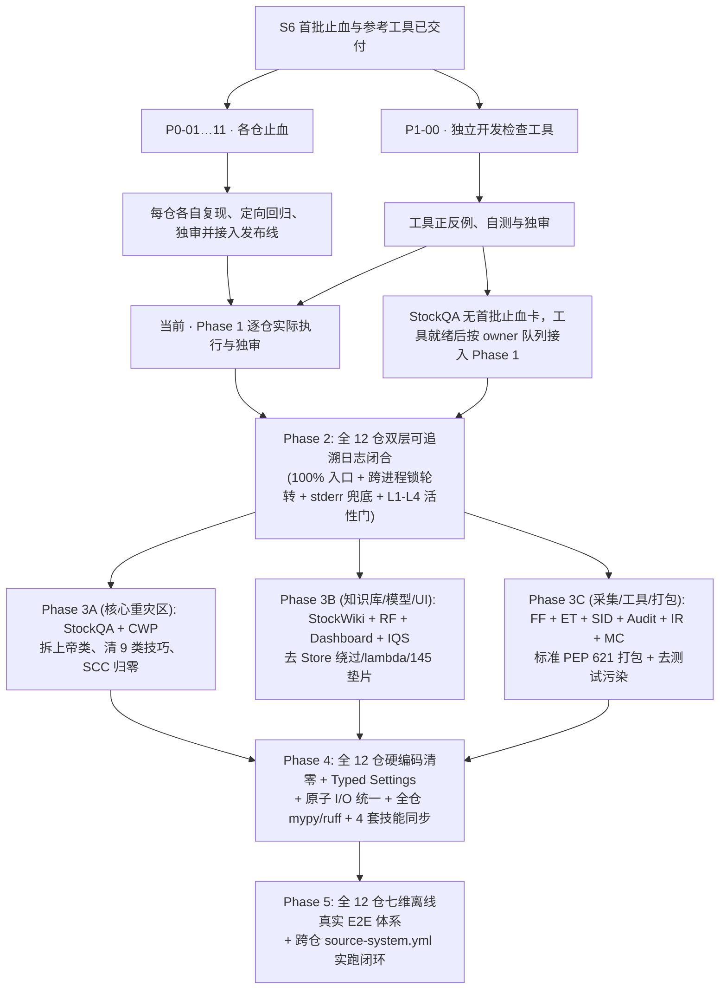

# S6 · 12 个模块的架构、日志和端到端测试整改

> **主线位置：`S6`（已接入 PWF 主线，作为 `feedback-loop-2026-11-17` S5-10 / F4 收尾线的直接后续，排在 W12 业务摘要恢复之前）**
> **当前状态** `IN_PROGRESS`。11 张止血卡已进入各仓发布线，P1-00 已独审发布。Phase 1 正按精确提交逐仓验证覆盖和实际执行，正式 T3 绑定及两个私有仓回执仍待核对。见 [progress.md](progress.md)。
> [前序 F4 正式回执](../feedback-loop-2026-11-17/f4-closeout-20261126.md) · [后续 W12 业务检查点](../du11-source-closure-2026-10-18/CURRENT_STATUS.md)
> **配套核心文档**：
> - **审查发现与逐仓 `file:line` 证据**：[findings.md](findings.md)
> - **防偷懒/反伪解耦四层治理机制**：[anti-trick-governance.md](anti-trick-governance.md)（含反模式、静态规则、行为验证和独审记录示例）
> - **逐仓目标架构与实施蓝图（M01–M12）**：[module-blueprints.md](module-blueprints.md)
> - **审查与验证日志**：[progress.md](progress.md)
> - **父级总控**：[CURRENT_STATUS.md](../du11-source-closure-2026-10-18/CURRENT_STATUS.md) · [模块边界计划](../module-boundaries-2026-11-11/task_plan.md) · [反馈工程计划](../feedback-loop-2026-11-17/task_plan.md)

## Goal

12 个模块各自维护代码和状态，经公开接口协作。按真实故障、上下层替换、完整溯源和原作业恢复验收。兼容既有线协议，保护原件及费用账本，所有工程验证使用隔离数据和本地替身。

## Current Phase

首批止血与参考工具均已发布。逐仓推进 Phase 1，根据实际 CI 失败修复共享根因，以精确提交的收集清单、执行回执和独审验收。只有实际依赖未发布 owner 资产的组合测试单列本机验收，公开套件与本机套件的合计覆盖仍需对齐。P0-12 按 owner 保留有在途工作或独有内容的工区。

---

## 全局执行编排与关键依赖图

## 实施分工和验收

| 工作 | 写入范围 | 验收时点及证据 |
|---|---|---|
| P0-01 至 P0-11 | 原派发者各写本仓止血实现和回归。CWP P0-06 使用 `C:/Temp/s6/cwp-p0`。 | 用当前发布目标验证失败，再在候选上通过同一用例，覆盖本卡其他故障。交出候选 SHA、命令和结果。独立审查员核对差异和关键反例；已有同版测试或 CI 可直接引用。有一仓通过即可并入该仓发布线。 |
| P1-00 | `C:/Temp/s6/cwp`，仅 `tools/anti_trick_gate_spec/` 内的参考工具、夹具、示例和说明。 | 在隔离夹具上证明已定义规则能发现违规并放行合法写法；抽一个真实目录确认工具能工作。独审聚焦漏报、误报及零运行期依赖。通过即可供 Phase 1 各仓采用。 |
| 总控与后续 Phase 1 | 总控只维护主仓 PWF 和接收记录；owner 负责本仓集成。 | 两条线分别验收。有止血卡的仓在两侧都就绪时汇合。StockQA 没有首批止血卡，工具验收后由既有 owner 排期。同仓变更重叠时由原 owner 在当前发布头合并，重跑受差异影响的用例。全仓离线套件及双平台覆盖集中在 Phase 1 的发布节点。 |

首批卡使用当下可执行的本仓测试。未建立的 AT/B 规则、工具安装、新双平台矩阵、另签蓝图或逐文件哈希都不属于它们的前置条件。已有精确版本的独审与测试只记录一次。原报告若在实际发布目标已修，提供原失败和现版回归，由独审确认结案。涉及 Windows 的行为用原生 Windows 取证。后续跨仓协议只在接口或组合发生变化时复验。

## Next Step

继续完成 CWP、RF、Audit 和 IQS 的实际执行与独审，按席位接续 Dashboard、StockQA、IR 和 MC。T3 的三市场、损坏原件、原作业冷读及零重发已通过离线组合，正式绑定单列核对。见[候选和发布台账](progress.md)。

---

## 分阶段详细施工卡（Phase 0 – Phase 5）

### Phase 0 — P0 线上实时缺陷止血与分支/工作区对齐
- **Status:** 11 张止血卡均已发布。正式 T3 绑定、私有 CI 回执和工区归属保留独立待办。
- 11 张各有发布目标上的修复或已修证据时，结束首批止血。P0-12 清理按工作区单独核销，只处理已有归属且可安全回收的目录。无须等待所有工作区一致才能交付止血修复。

| 卡号 | 责任仓 | 精确落点与详细施工动作 | 关键行为与验证用例 |
|---|---|---|---|
| **P0-01** | `revenue-forecast-audit` | 修复 `skills/revenue-forecast-audit/scripts/feedback_owner.py:187` 实时 `NameError`（`_capture_events` → `select_capture_events(run, metadata, role, native_id, audit.canonical_role_events)`）。 | 真实子进程 `feedback_owner.py replay` 覆盖 `audit-capture`/`audit-finding`/`audit-operation` 三家族，验证冷读与幂等重放。 |
| **P0-02** | `earnings-transcripts` | 修复 `reader.py:21,36` `__TEMPLATE_FILE`/`_TEMPLATE_FILE` 实时 `NameError`；为 `retrieval_runtime.py:317-323,386-409` 补齐 Windows `CREATE_NO_WINDOW` 与 Job Object / POSIX 进程组回收。 | 真实 `reader.py` HTTP `GET /` 返 200；Windows 真实子进程强杀探针证实孙进程 0 残留且本次进程树新增可见控制台窗口数为 0。 |
| **P0-03** | `industry-research` | 抽取共享 JSON 键常量修复 `deepseek_client.py:603` (`evaluation_basis`) vs `report_generator.py:596` (`recommendation_basis`) 静默丢数据（兼容旧键）；接通死参数 `--model:660`；抽取统一 `_write_json_atomic` 修复 6 处 bare filename 崩溃。 | `evaluate_company → report_generator` 端到端测试断言推荐依据非空；`--model` 透传到请求体；`--output out.json` 在临时空目录成功原子落盘。 |
| **P0-04** | `StockWiki` | 建立唯一 `stockwiki/core/sqlite_uri.py`（`.resolve().as_uri() + "?mode=ro"`）修复 `dashboard_onboarding.py:145`、`quick_scan_identity.py:151`、`security_id_normalization_store.py:71`、`quick_scan_observations.py:212`；删 `dashboard_onboarding.py:502` 死三元与 `quick_scan_store.py:404-415` 3 块重复 `if`；修 `_save_prepared():402` 越权 `commit()`；给 `ui.py:255` POST 加 `MAX_POST_BYTES` 上限。 | Windows 使用含 `#`/`%` 的合法目录，POSIX 补测含 `?` 的目录，真实 SQLite 读准原库且未新建错库；超限 POST 返 HTTP 413；事务回滚探针证明 `_save_prepared` 不越权提交。 |
| **P0-05** | `invest-quick-scan` | 抽统一 `foundation/file_lock.py` 修复 `dashboard_jobs.py:156-168` 80ms 魔数重试静默 `break`（可配置等待超时 + 超时后强制落盘可冷读终态，绝不困在 `'preparing'`）；为 `open_dashboard.py:168` 与 `tools/run_tests.py:134` 补 `CREATE_NO_WINDOW`。 | 注入 200ms 锁占用并发测试，断言失败作业准确迁移至终态且冷读可见。 |
| **P0-06** | `company-wiki` | 重构 `dayu_cli_adapter.py:220-260` 改走公开 `bounded_process.run_bounded`（显式环境白名单剔除 `RESEARCH_FEEDBACK_*` 与无关密钥、流式排空管道防 >64KiB 死锁、Job Object 回收孙进程、stderr 脱敏）；核对既有输入预算。依据 `3d822c41e` 已取消的表示限制，删旧死常量，保留有效请求预算及独立的业务边界。 | 子进程吐出 512KiB stdout+stderr 不死锁且子环境零密钥泄漏；验证合法的大 JSON 继续被接收，并复验已有实际限额的结构化错误。 |
| **P0-07** | `filing-fetch` | 为 `ff_scheduled_windows.py:208-212` 补显式可配置 `timeout=`；将 T3 探针逻辑从 `tests/test_e2e_download.py` 抽至正式模块，移除 `ff_t3_receipt.py:350-379` 对 `tests/` 的 `exec_module`；保留原输入协议和 `622a6a4` 已验收的本地配置读取；继续执行既有采集限额。 | 阻塞子进程在超时边界稳定退出并写轮转日志；在只含正式模块的隔离目录执行 T3 探针；确认运行时无需 `tests/`。 |
| **P0-08** | `StockInfoDLSimple` | 统一 `cninfo_api.py:422-424` 无预算与有预算 `fetch_pdf` 为同一流式路径，强制校验 `Content-Length` 防截断 PDF；移除 `:487-489` 先 `unlink` 再 `replace` 窗口并在 `feedback_files.py:40` 补 Windows `WinError 5/32` 重试。 | 本地 `127.0.0.1:0` HTTP 替身发 `Content-Length: 10000` 实际只发 500B `%PDF-` 后断连，断言稳定拒收；替换失败时原文件完好。 |
| **P0-09** | `revenue-forecast` | 修复 `scripts/contracts/document.py:1210,1258,1316-1325`：收窄 `except` 仅捕获显式领域校验异常，内部编程错落盘完整堆栈并显式失败不伪装为输入校验错。 | 注入模拟引擎 `KeyError`/`AttributeError` 回归测试，断言不进入用户校验错误列表而是显式抛出并落日志。 |
| **P0-10** | `MeetingConverter` | 修复 `audio_utils.py:30-45` `ffprobe` 校验 `returncode != 0` + 可配置 `timeout=` 抛 `AudioProcessError`；修复 `transcribe.py:173-188` 遇到非法 `config.json` 时 fail-closed（不再无校验回退或静默关闭翻译）。 | 坏音频/超时 `ffprobe` 子进程回归 + 非法 `config.json` 真实 CLI 回归全绿。 |
| **P0-11** | `investment-dashboard` | 按[交接台账](progress.md#首批交接台账)在当时的 owner 发布头整合本卡差异，保留 RF verified-scope 配置、owner 作业分页和已发布资产。统一构建校验 `apps/web/dist`；`http.py:469-483` 缺失 `dist/index.html` 启动期 fail-fast（除非 `--api-only`）；`main.py:52-55` 禁止吞 `adapters.factory` `ImportError`；`main.py:67` `--data-dir` 为文件时立即报错禁止退回 `Path.home()`。 | 缺 `dist` / 坏 `--data-dir` / 损坏 adapter 导入均非零退出并写诊断，真实 `Path.home()` 零写入。 |
| **P0-12** | **全生态分支与工作区卫生** | 总控只读列出工作区、归属、独有提交与运行用途。由所属 owner 核实并处理确已弃用且无独有内容的目录。存在分叉、活动修改或运行进程时保留原工区，单列记录。 | 记录各 owner 的发布分支、实际运行版本及工作区归属；在途、含独有内容和运行中的目录保留。 |

---

### Phase 1 — 防偷懒机械安全网落地、CI 假绿清零、Windows 矩阵与历史缺陷 100% 锁定
- **Status:** P1-00 独审完成并发布。P1-03 ET、P1-04 SID 发布版双平台 CI 通过。P1-02 FF 精确主线双平台通过。P1-07 StockWiki 在独审及 Windows 全量与 C06 通过后快进本地主线，Linux 未实跑。CWP 处理中途真实 CI 失败，RF 候选双平台通过待独审，Audit 原生全量通过，正在按独审要求隔离各分片，IQS 已启动。
- P1-00 与止血并行。后续各仓将适用规则接入本仓现有 CI；见上表的汇合条件。

| 卡号 | 范围 | 具体施工细节 | 退出硬指标 |
|---|---|---|---|
| **P1-00** | **全生态标准门禁规范** | 在 `company-wiki/tools/anti_trick_gate_spec/` 沉淀零外部依赖参考实现（支持 `AT-01..AT-12` + `ratchet_baseline.json` 格式 + `B-01..B-04` 通用测试夹具模板 + `review_receipt.json` 校验脚本），各仓按单仓独立拷贝/定制使用（零跨仓运行期导入依赖）。 | 门禁自身通过正反例自测（能 100% 抓获 AP-01..AP-10 全部 10 种合成作弊代码，且零误报合法 `Protocol` 组合代码）。 |
| **P1-01 ~ P1-12** | **逐仓 CI、Windows 矩阵与历史缺陷锁定（每仓 1 卡）** | 按 [module-blueprints.md](module-blueprints.md) 逐仓实施： 1. 废除全部硬编码樱桃采摘测试列表（CWP `CI_CONTRACT_CASES`、FF `CI_TESTS`、ET 4 文件清单、SID 7 文件清单、RF 75 项 `CI_TESTS`、StockWiki `SHORT_TESTS`、IQS 7 文件清单、Dashboard 3 文件清单与坏 `testpaths`、StockQA `DAILY_TEST_TARGETS`、IR 7/15 清单），统一改为 pytest 目录发现 + `@pytest.mark.{unit,contract,e2e_offline,regression,live}`； 2. 补齐 `windows-latest` CI 矩阵（含更新 MC `test_ci_workflow_config.py:79-89` 解除单 OS 限制）；Audit 建 `.github/workflows/ci.yml` + 本地 `.githooks/pre-push` 门禁；CWP `source-system.yml` 增加 `src/**` 触发； 3. 每仓落地 `tests/contract/test_anti_trick_gates.py` + `ratchet_baseline.json`（先锁定存量上限防新增，Phase 2–4 逐阶段归零）； 4. 补齐 `findings.md` 中所有尚未在 CI 执行的 35+ 类历史缺陷回归用例（如 StockQA Bearer 脱敏与坏 checkpoint、ET 启动失败/stderr/reader、SID `cninfo_api`/`downloader`、IQS `IncompleteRead`/多题去重、Audit `audit-capture` replay、FF Windows 定时 tick 与 schema 2.0、StockWiki 跨库提交与 `#`/`%` URI、Dashboard 幽灵 `correlation_id`、MC `ffprobe` 与 CLI 优先级）。 | `AT-12`（CI 收集覆盖非 `live` 测试 **100%**）在全部 12 仓通过；10/10 有远端仓在精确 SHA 通过 **Ubuntu + Windows** 双平台 CI（私有仓附完整本机双验+待登录核验记录；无远端仓通过本地预推门禁）。 |

---

### Phase 2 — 全 12 仓统一双层可追溯日志与错误传播体系闭合
- **Status:** pending
- **前置**：每仓开工前须提交 100% 入口盘点表（Step 0），严禁“只改 1 个试点入口就宣称完成”（AP-10）。

| 卡号 | 范围 | 具体施工细节 | 退出硬指标 |
|---|---|---|---|
| **P2-01 ~ P2-12** | **12 仓全入口轮转日志与错误链闭合（每仓 1 卡，可按仓并行）** | 按 [module-blueprints.md](module-blueprints.md) 逐仓落地统一双层日志规范： 1. **100% 入口覆盖**：所有 CLI、HTTP、Worker、Scheduler、`feedback_owner`（补齐 CWP 3 console scripts+`scheduled_reading`、FF `JobStore.append_log`、ET 4/6 入口、SID `feedback_owner`/`main` 早期启动、RF 16+ CLI、Audit 11+ CLI、StockWiki 5 入口、IQS `open_dashboard`、Dashboard `main`/uvicorn/adapters、StockQA 11 二级 CLI+`feedback_owner`、IR 10 业务文件+`feedback_owner`、MC `feedback_owner`/库模式）； 2. **并发轮转 + 写入点强脱敏**：跨进程文件锁（`msvcrt`/`fcntl`）+ Windows `PermissionError` rollover 保护（重点修复 Dashboard `_RuntimeLog`、IR `native_feedback`、Audit `doRollover`、FF `JobStore`）；统一覆盖 `Authorization: Bearer/Basic`、多行折行凭据、URL userinfo、`sk-`/`tvly-`/`ghp_`/`AIza`； 3. **绝不静默丢日志、绝不污染 `stdout`**：撤销 CWP `warn_on_stderr=False`、ET `warn_on_failure=False` 与 FF/RF/StockWiki/IR 静默吞错；将 StockQA `logger.py:588`、MC `transcribe.py:127`/`core/feedback.py`、IR `deepseek_client.py` 日志与告警写入所属诊断通道；已用 stderr 承载整份 JSON 回执的入口按原协议保留机器输出； 4. **根治堆栈自毁**：StockQA `logger.py:407` 改为**尾段截断**保留异常类与最后栈帧；CWP `triage_diagnostic.py` 与 ET `retrieval_diagnostics.py` 保留自定义异常类；IQS `runtime_feedback` 开放脱敏诊断摘要；Dashboard 消除 `http.py:317`/`main.py:89` 幽灵 `correlation_id`、给 `adapters/common.py:fail()` 补 `cause`、给 `cwp_stream.py` 补 `child_result()`、前端 `OriginalPreview.tsx`/`<Load>`/`api.ts`/`capabilities.ts` 全透传展示 `correlationId`；清零全生态 **256 处无日志 `from None`**、**146 处缺 `exc_info=True`** 与静默 `except Exception`； 5. **日志活性门禁（L1–L4 / B-04）**：每仓固化“坏输入带合成凭据落盘脱敏尾栈”与“双只读目录保原退出码+stderr 告警”真实子进程回归。 | 12 仓入口轮转日志覆盖率 **100%**；`AT-11` 日志项清零；`B-04(a)(b)` 全部真实子进程通过；Dashboard 前后端真实浏览验证失败页可见可查 `correlationId`。 |

---

### Phase 3 — 架构级真正解耦、封装收口与 PEP 621 标准化打包（清零 AP-01..AP-10）
- **Status:** pending
- **核心纪律**：以逐仓蓝图约束职责、公开协议和允许的依赖。涉及边界取舍时由相关 owner 在动工前评审接口；在模块交付时做独立审查，按实际变化选择阻断导入、纯端口替身或洁净安装测试。

| 批次与卡号 | 目标模块 | 核心架构重构摘要（详图见 [module-blueprints.md](module-blueprints.md)） | 不可伪造的退出硬指标 |
|---|---|---|---|
| **Wave 3A-1 (`P3-01`)** | `StockQAbyLLM` | 拆 7,085L `quick_scan_work_store.py` 为 `sqlite_engine` + 7 领域 Repo；拆 3,687L `llm_runner.py`；删 17 个 `api_*` 别名与重复 `MODULE_API_PROTOCOL`；`ReadOnlySQLiteEngine` 组合替继承+`__getattribute__`；显式 `DispatchContext` 替 9 全局 `ContextVar` 与 `WeakKeyDictionary`；消 `sys.path.insert`。 | SCC `23→0`；`STORE_SQL_ADAPTERS` `21→0`；延迟导入 `384→0`；私有属性 `46→0`；最大文件 `7,085→≤600L`；B-01/B-02/B-03 全绿。 |
| **Wave 3A-2 (`P3-02`)** | `company-wiki` | 267 文件 `source_catalog/` 拆为 7 层显式子包 DAG；清零 8 条 `_COMPATIBILITY_PORTS`；拆 `automation/store.py` 为 Repo + `UnitOfWork` + 监听器；在生产树启用 `runtime_import_cycles() == ()` 强制断言；统一 `catalog_storage` 单 SQLite Owner；隔离历史 `scripts/`。 | SCC `18→0`；`_COMPATIBILITY_PORTS` `8→0`；延迟导入 `1,706→0`（除 `# optional-sdk:`）；存储包外 `sqlite3.connect` `54→0`；B-01/B-02/B-03 全绿。 |
| **Wave 3B-1 (`P3-03`)** | `StockWiki` | 删除 `_ReadStore`/`_ReadReceipts`/`_ReadOnlyObservationStore` 子类与全部外部 SQL，建公开只读仓储；拆 2,565L `public_company_assessments.py`；破 3 环并撤 `test_f05` 循环豁免、扩扫描至全包；根 CLI 入 `pyproject.toml`；跨库 Saga 状态机显式化。 | SCC `3→0`；存储包外 `sqlite3.connect` `66→0`；跨域私有导入 `290→0`；`sys.path.insert` `10→0`；B-01/B-02/B-03 全绿。 |
| **Wave 3B-2 (`P3-04`)** | `revenue-forecast` | 建 `pyproject.toml` (`src/revenue_forecast/`)；拆 1,512L `rf_job_facade.py` 并将 `FakeStageRunner`/`SimulatedProcessDeath` 移出至 `tests/doubles/`；建 `CatalogRepository(Protocol)` 消 `catalog._*` 与环；依赖倒置解除 `revenue_core` 回调/`E402`；拆 995L `_validate_forecast_output`。 | SCC `1→0`；私有导入/属性 `22/19→0`；延迟导入 `148→0`；`sys.path.insert` `18→0`；生产零测试替身；B-01/B-02/B-03 全绿。 |
| **Wave 3B-3 (`P3-05`)** | `investment-dashboard` | 解散 629L `DashboardService` 与 37 个 `lambda` 闭包为独立构造注入用例服务；注入 `IdentityPort` 入 `ResearchAdapter`；`ChainedIdentityAdapter` 替 `self._fallback._read()`；拆 1,082L `iqs/quickscan.py`；清除 `f2_dash_feedback_sample.py` 导 `tests` 与 `feedback_owner.py` 直连 SQLite；修前端 `Documents.tsx` 跨 feature 导入与 `handoffs/` 旧脚本。 | 37 `lambda` 伪端口 → `0`；adapters SCC `21→0`；跨文件私有导入 `35→0`；生产零 `tests` 导入；B-01/B-02/B-03 全绿。 |
| **Wave 3B-4 (`P3-06`)** | `invest-quick-scan` | 建 `pyproject.toml` (`src/iqs_scan/` + `[project.scripts]`)，清退 **145 个 `sys.modules[__name__]` 垫片**；删 `legacy_oracle.py` 跨仓导 `stockwiki` 与测试跨仓导 StockQA `tests.*`；拆 5 个 >950L workbench 巨石，不可变 `RequestContext` 替 `copy.copy(self)`；边界扫描扩全包。 | `sys.modules` 垫片 `145→0`；跨仓导入 `2→0`；延迟导入 `280→0`；最大文件 `1,529→≤600L`；B-01/B-02/B-03 全绿。 |
| **Wave 3C (`P3-07` ~ `P3-12`)** | `FF` / `ET` / `SID` / `Audit` / `IR` / `MC` | 6 仓统一建立/修正 PEP 621 `pyproject.toml` (`setuptools.build_meta`, `src/`, `[project.scripts]`) 清零 `sys.path.insert` 与 `spec_from_file_location`；拆分各仓巨石（FF `fetch_filing.py` 2,095L、ET 3 巨石并清 `main()` 私有参数、SID `feedback_publish.py` 退 `orgid.py`/`StockDownloader`、Audit `audit_run`/`pool_progress` 破 6 文件环、IR `quick_scan_client.py` 2,240L 让离线命令脱 `--config`、MC `core/feedback.py` 1,487L 去全局 `_RECORDERS` 并合 3 份异常链提取器）。 | 6 仓均达成：SCC = `0`、私有导入/属性 = `0`、`sys.path.insert` = `0`、生产零测试导入、空目录 Wheel 安装（B-03）全绿。 |

---

### Phase 4 — 全 12 仓硬编码清零、强类型配置化、原子 I/O 统一与静态质量硬化
- **Status:** pending
- **施工内容（`P4-01` ~ `P4-12`）**：
  1. **零个人路径与邻仓猜测**：清零 StockWiki/IR/CWP/IQS/RF/Dashboard 全部硬编码 `C:\Users\郑曾波\...`、`C:/Miniconda`、`../StockWiki`、`.venv/Scripts/python.exe`，统一由 env / 部署配置注入，缺配即报错。
  2. **单一强校验 `Settings` 对象**：集中 URL、模型、端口（统一 IQS 8766 / Dashboard 48766）、超时/重试/退避、字节上限、锁超时、轮转参数、提示词与行业/市场资源表；剔除全部死配置与死代码（FF 3 个 `pause_worker`、SID 5 个死 config 键、IR 死 `--model`/死 `categories`、MC 死 `translate_batch_size`、ET 微软产品词与过时 v3 URL、RF W09/Q3-2026 与 `slo_probe` 假 bundle、CWP `narrative_business_meaning` 词典正则）。
  3. **重复原语统一与原子 I/O 硬化**：全生态消除重复原子写（补齐 `os.fsync` + Win32 `WinError 5/32` 重试）、重复严格 JSON 解析、重复 CLI 解析模板、非确定性 `hash()`（MC）、过时 `asyncio.get_event_loop()`（StockQA）与手写 YAML 解析器（IR）。
  4. **全局技能同步器清单化**：升级 IR/Audit/FF/RF 技能安装器覆盖全部 4 套入口（`.agents`/`.claude`/`.codex`/`.gemini/config`），新增孤儿文件漂移检测与洁净目录自动化测试。
  5. **全仓 `ruff` + `mypy` 拉齐**：移除 CWP `follow_imports = "skip"`（按层收紧），扩满 FF/RF `mypy`，全 12 仓 CI 必跑 `ruff` + `compileall` + `mypy`。

---

### Phase 5 — 全 12 仓七维真实端到端（E2E）测试重构与跨仓闭环验收
- **Status:** pending
- **施工内容（`P5-01` ~ `P5-12` + `P5-CROSS`）**：
  1. **每仓落地统一“七维离线真实 E2E 矩阵”**（真实安装 CLI/HTTP 子进程 + `127.0.0.1:0` `ThreadingHTTPServer` 替身 + 隔离 `tmp_path`，严禁用进程内 `monkeypatch`/`FakeStageRunner`/`runpy` 替代真实传输与配置加载）：
     - ① **主链正向与精确线协议**（含 FF **schema 2.0** + companion、IR `deepseek→report_generator→render/audit`、Audit 全 7 步链、Dashboard 真实编译 `apps/web/dist`）；
     - ② **启动期/坏配置前移失败**（首次外部/写库前 fail-fast、落轮转日志、零污染 `Path.home()`）；
     - ③ **运行中强杀（`TerminateProcess`/SIGKILL）+ 冷恢复 + 幂等零重复**（孙进程 0 残留、按原作业冷读，恢复前后外部请求计数增量为 0；派发前强停可为 0，已派发为 1，未知费用保留原态、迟到旧子进程写隔离）；
     - ④ **上游截断/损坏/畸形响应**（HTTP 200 头后真实断流、`Content-Length` 截断、超限 stdin、坏 SQLite/坏 checkpoint/断行 JSONL）；
     - ⑤ **日志/旁路/磁盘双失败韧性**（业务结果与退出码不变、使用入口约定的诊断通道，结构化 stderr 保持可解析、`stdout` 协议纯净、`correlation_id` 端到端一致）；
     - ⑥ **Windows 原生语义专项**（在 Windows 实测本次进程树新增可见控制台窗口数为 0、`#`/`%`/260+ 路径、并发轮转、`WinError 5/32` 原子替换、`os.link` 回退）；
     - ⑦ **洁净安装态与 4 套技能同步复验**（无源码空目录运行全部入口、二次同步零写入、孤儿残留检测）。
  2. **跨仓集成总验收（`P5-CROSS`）**：在 `company-wiki` 经 `source-system.yml`（含 `src/**` 触发）实跑跨仓 CWP↔FF↔ET↔SID↔RF↔StockWiki↔Audit↔IQS↔Dashboard 公开协议组合回归，绑定全部 12 仓精确发布 SHA，汇总最终独立验收报告。

---

## 生产安全与回退保障

- **零生产污染**：一切测试/验证使用 `tmp_path` 或独立隔离根；绝不写入生产 `config/source_catalog.yaml`、原件目录、生产 SQLite、F4 正式动作库或用户主目录。
- **零未授权外部/付费请求**：全部 Phase 0–Phase 5 离线验证使用本地 `127.0.0.1:0` HTTP/CLI 替身，外部供应商调用与费用严格 = 0。
- **集成与回退**：记录 owner 的发布目标与候选 SHA，保留前一发布版本。并线冲突由 owner 处理，保留在途工区和原始证据。

---

## 尚待处理的事项

P0-12 在确认目录归属后逐项处理。无远端的仓保留本地发布 SHA 和可复现测试。历史 `scripts/` 的迁移属于 Phase 3，先清点真实入口和调用者，再由 owner 决定保留兼容入口或归档。
