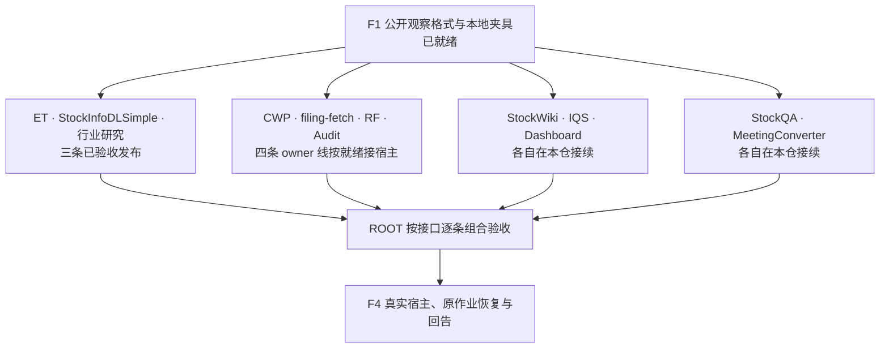

# F2 分仓实施与并行路线

F2 的目标是让每个模块从自己的原生日志产出可复现观察。以 [F1 的观察协议](interfaces.md)和本仓夹具为输入，模块可以各自实施、定向复验并独审。每个工作树只安排一个写者。已有活动项目从同仓 PWF 接续即可。

| 工作 | 可直接并行的部分 | 组合时所需的前置 |
|---|---|---|
| ET、StockInfoDLSimple、行业研究 | 各仓原生步骤、失败链、用量观察均已验收发布 | 启用自动修理和回告时消费对应仓公开结果。见[首批收据](f2-owner-acceptance.md) |
| CWP、FF、RF、Audit | 原生起止记录、公开 DTO、回归和独审各自可做 | 验证 RF 的真实来源链时用可用的 CWP、FF 端口。Audit 复验要有待重放的 RF 公开版本 |
| StockWiki、IQS、Dashboard | 用稳定 DTO 夹具各做本仓观测、错误分类、复现测试 | 组合时 StockWiki 使用 CWP 证据，Dashboard 使用各模块真实公开输出。IQS 与 StockWiki 的本仓施工无需互等 |
| StockQA、MeetingConverter | 可各在本仓处理检索来源和转录结果的原生反馈 | 跨仓验收使用实际调用方产物。独审和接入跟随各自工程节点 |

MeetingConverter 转录发布反馈与 FF 单次 CLI 反馈已由两个独立 harness 并行施工，接口和工作树见[分工](dispatch.md#本批施工中)。StockWiki、IQS、Dashboard 和 StockQA 的相关工作由原项目接续。哪个公开接口和独立测试先就绪，哪个先进入 ROOT 组合复验。Dayu 由 CWP 适配器观测，属于外部 provider。
