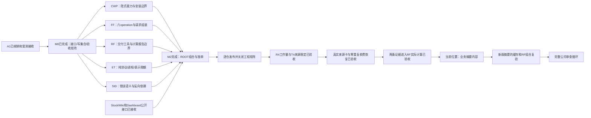

# 模块化与解耦：一次有明确出口的收口

**M2 已完成。** 五条模块施工卡已受测并入各自主线并推送。StockWiki 公开来源读取已进入本地 `master`，Dashboard 的公开浏览、原件流和摘要读取已推送 `main`。D4 跨仓回放 30 项全过，E01–E09 均有组合证据。 [组合记录](review/root_composition_20261114.md) · [矩阵](boundary_matrix.json)

M2 之后的工作区续核不改变上述结论，也不允许恢复旧的跨层实现。Dashboard 三项未收口材料按文件域拆开：[C01证据可移植性](harness_lanes/dashboard_c01_evidence_portability.md)、[B-real预览模块适配](harness_lanes/dashboard_preview_module_adapter.md)、[B03独审收据收口](harness_lanes/dashboard_b03_review_closeout.md)。唯一处置表在 [reconciliation.md](reconciliation.md)，并行写集合见 [dispatch.md](dispatch.md)。

当前实施已回到 [父计划](../du11-source-closure-2026-10-18/CURRENT_STATUS.md)。R4 和 T4/SEM 已验收，真实来源卡的付费恢复和两条 RF 实际采用通过。正在修正业务摘要内容。

先读 [task_plan.md](task_plan.md)，再读 [architecture.md](architecture.md)、[interfaces.md](interfaces.md)、[acceptance.md](acceptance.md)。并行安排和卡片见 [dispatch.md](dispatch.md)，交接格式见 [handoff_contract.md](handoff_contract.md)，机器对照见 [boundary_matrix.json](boundary_matrix.json)。

## 为什么一直没有收尾

已有成果是真实的：D4/D5冻结接口与组合、P3 source stream/parser都已完成各自范围。但过去有四个收尾问题：

1. 用局部接口通过来表述全局完成，随后又发现仓内或分发入口遗漏，完成口径不断变动。
2. 从一个失败顺着私有helper/AST反例继续修，缺少覆盖所有活动入口、配置、状态和安装产物的有限矩阵。
3. 同一“解耦”队列混入摘要召回、资源工作量、研究质量、CI环境及历史工区整理，无法按一个清楚的出口关闭。
4. 源码目录测试允许src/scripts/PYTHONPATH共存；主流程接口已公开，旧工具、隐藏配置、协议外属性和实际部署版本仍可落在盲区。

调查也纠正了误判：退休的CWP launcher不是当前产品故障，RF主线少某些Dashboard入口也不等于部署故障，因为可见配置使用独立release代码根。这些不作为修复数量膨胀的理由。源证据见 review/root_baseline.md 及三份架构报告。

## 路线图

五卡可在不同工区并行，彼此不写对方repo。CWP内部七责任由一个作者顺序完成，避免多作者同时改同一个catalog/边界测试。ROOT管理接口、集成和并线，并在StockWiki自己的隔离工区接收C38/B03差额，不与五卡作者同时写其生产代码。

## 已接收的五份独立施工卡

| 卡 | 预计相对工作量 | 工区（Projects下） |
|---|---|---|
| [MB-CWP](harness_lanes/MB-CWP.md) | 大：七责任、四确认缺口、安装验收 | mb11-cwp |
| [MB-FF](harness_lanes/MB-FF.md) | 中：真实CLI隔离；无缺陷允许NO_CHANGE | mb11-ff |
| [MB-RF](harness_lanes/MB-RF.md) | 中到大：分发/计算报告/历史profile隔离 | mb11-rf |
| [MB-ET](harness_lanes/MB-ET.md) | 中：协议依赖方向和结果限额 | mb11-et |
| [MB-SID](harness_lanes/MB-SID.md) | 中：11项旧WIP接收、typed错误与纯metadata | mb11-sid |

五卡经定向测试和独立审查后交付。ROOT 在各自隔离工区完成接收与组合，清理记录见 [对账表](reconciliation.md)。

## 完成的含义

本计划关闭表示：当前登记的活动入口只能通过公开接口通信，纯域/配置/存储职责清楚、真实交付包可独立运行、替换实现和越界反控能稳定验收、已并入各自正确主线。后续新的业务缺陷仍归所属模块；不会因为出现研究或摘要质量问题再把这次架构结论说成从未完成。

A1 的分支与未提交文件处置见 [对账表](reconciliation.md)。M2 使用现有原件、冻结快照与隔离测试配置，测试安装使用临时目录。
