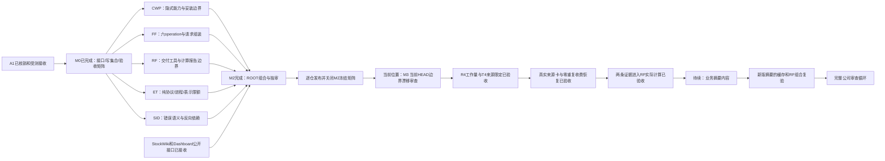

# 模块化与解耦：一次有明确出口的收口

**2026-11-16。** [各模块计划入口与交接](owner_plans.md)按本轮 Git 与 PWF 对账更新。CWP 的浏览请求、目录投影和 PDF 解析边界已通过独审和定向测试并发布为 `12e65fe7d`。M3 仍待 FF 有限下载 T3 和 RF 周跑对账，见 [task_plan.md](task_plan.md)。下方 11-15 记录按其当时版本阅读。

**M2 已完成。** 五条模块施工卡已受测并入各自主线并推送。StockWiki 公开来源读取已进入本地 `master`，Dashboard 的公开浏览、原件流和摘要读取已推送 `main`。D4 跨仓回放 30 项全过，E01–E09 均有组合证据。 [组合记录](review/root_composition_20261114.md) · [矩阵](boundary_matrix.json)

## 2026-11-15 快照

**M3 当前 HEAD 漂移审查仍 OPEN。** M2/E01–E09 仍仅对冻结版本有效。CWP 最终修复 `master@56d10f269b7c67845c7af66b33083f62d46cde4d` 已推送且 exact-head GitHub CI run `43765642890` / job `132969996667` 通过（Python 3.12，7m13s）；此前远端 `3e7b723` 的产品代码 `707efe814` 已包含在该最终提交父链。共享请求预算修复的 62 项受影响测试和独立审查通过。另一项目的 StockWiki handoff 曾基于本地 `7fd7f248d` 512MB候选做记录；这属于历史状态，现由 `56d10f2` 的统一预算根因修复替代，外仓未改。FF `main@dd716217` 与 fresh live `origin/main` 一致且 tracked-clean；S3 BYD E2E 仍不替代四个 RF 周测 T3 下载请求的有限限额及当前主线复跑。RF `main@be0caa4` 比 fresh live `origin/main@f2215959` 超前 9 个提交，三项 tracked assurance 文件有修改；周跑 `20261115T084227Z` 仍 not-ok，未见于 canonical PWF。StockWiki `master@54f72c9` 无 remote、tracked-clean；其根 `task_plan.md` / `progress.md` 已于 `5f79e7b` 更新、最新 handoff 为 `54f72c9`，ROOT 已只读核对。用户说明外仓变化由另一项目推进；ROOT 只对账、不回退、清理或覆盖。外仓 untracked 未枚举。M3 现只待 FF/RF owner 证据，之后再绑定精确 refs 出有限报告；I10/I11 已有互操作证据，不重跑。实施细则见 [M3 task plan](task_plan.md#M3--当前-HEAD-边界漂移审查2026-11-15-新增)。

另已修正 CWP 根 PWF 文档的 push 分类和 Windows pytest 临时 Git 对象清理，`master@56f9cc73d` 已推送；测试与独审证据见 [M3 progress](progress.md)、[findings](findings.md) 和[独审报告](review/pre-push-classification-and-temp-cleanup-20261115.md)；这项工程维护不改变外仓 M3 出口。

M2 之后的工作区续核不改变上述结论，也不允许恢复旧的跨层实现。Dashboard 三项历史卡现已按 Dashboard owner 的 11-14 收尾记录重新分类：C01 证据可移植性已由 `c8939e5` 吸收；B-real 预览模块适配尚未执行，原卡基线已过时，开工前必须按当前 `main@3f83bb5` 重做路径对账；B03 独审收据仍不完整，属于证据收口而非产品实现。后两项是 Dashboard owner 后续事项，不是 CWP M3 的接口阻塞。卡片与证据入口：[C01](harness_lanes/dashboard_c01_evidence_portability.md)、[B-real预览](harness_lanes/dashboard_preview_module_adapter.md)、[B03](harness_lanes/dashboard_b03_review_closeout.md)。唯一处置表在 [reconciliation.md](reconciliation.md)，并行写集合见 [dispatch.md](dispatch.md)。

当前优先事项是收齐 FF 当前主线 T3 与 RF canonical PWF owner 证据，关闭有限 M3。CWP shared-read-budget 根修复已发布并在精确 SHA `56d10f2` 取得 GitHub CI 通过；StockWiki 最新 root PWF 已更新并由 ROOT 只读核对，不需要重复施工。R4 和 T4/SEM、真实来源卡的付费恢复、两条 RF 实际采用已有验收；业务摘要 P1 仍待续办，按顺序在 M3 关闭后回到[父计划](../du11-source-closure-2026-10-18/CURRENT_STATUS.md)。固定公司循环继续暂停。

## 当前文档入口

先读 [task_plan.md](task_plan.md) 和 [各模块计划入口](owner_plans.md)，再读 [architecture.md](architecture.md)、[interfaces.md](interfaces.md)、[acceptance.md](acceptance.md)。并行安排见 [dispatch.md](dispatch.md)，交接格式见 [handoff_contract.md](handoff_contract.md)，机器对照见 [boundary_matrix.json](boundary_matrix.json)。

## 为什么一直没有收尾

已有成果是真实的：D4/D5冻结接口与组合、P3 source stream/parser都已完成各自范围。但过去有四个收尾问题：

1. 用局部接口通过来表述全局完成，随后又发现仓内或分发入口遗漏，完成口径不断变动。
2. 从一个失败顺着私有helper/AST反例继续修，缺少覆盖所有活动入口、配置、状态和安装产物的有限矩阵。
3. 同一“解耦”队列混入摘要召回、资源工作量、研究质量、CI环境及历史工区整理，无法按一个清楚的出口关闭。
4. 源码目录测试允许src/scripts/PYTHONPATH共存；主流程接口已公开，旧工具、隐藏配置、协议外属性和实际部署版本仍可落在盲区。

调查也纠正了误判：退休的CWP launcher不是当前产品故障，RF主线少某些Dashboard入口也不等于部署故障，因为可见配置使用独立release代码根。这些不作为修复数量膨胀的理由。源证据见 review/root_baseline.md 及三份架构报告。

## 路线图

五卡可在不同工区并行，彼此不写对方repo。CWP内部七责任由一个作者顺序完成，避免多作者同时改同一个catalog/边界测试。ROOT管理接口、集成和并线，并在StockWiki自己的隔离工区接收C38/B03差额，不与五卡作者同时写其生产代码。

## 已接收的五份独立施工卡

| 卡 | 预计相对工作量 | 工区（Projects下） |
|---|---|---|
| [MB-CWP](harness_lanes/MB-CWP.md) | 大：七责任、四确认缺口、安装验收 | mb11-cwp |
| [MB-FF](harness_lanes/MB-FF.md) | 中：真实CLI隔离；无缺陷允许NO_CHANGE | mb11-ff |
| [MB-RF](harness_lanes/MB-RF.md) | 中到大：分发/计算报告/历史profile隔离 | mb11-rf |
| [MB-ET](harness_lanes/MB-ET.md) | 中：协议依赖方向和结果限额 | mb11-et |
| [MB-SID](harness_lanes/MB-SID.md) | 中：11项旧WIP接收、typed错误与纯metadata | mb11-sid |

五卡经定向测试和独立审查后交付。ROOT 在各自隔离工区完成接收与组合，清理记录见 [对账表](reconciliation.md)。

## 完成的含义

本计划关闭表示：当前登记的活动入口只能通过公开接口通信，纯域/配置/存储职责清楚、真实交付包可独立运行、替换实现和越界反控能稳定验收、已并入各自正确主线。后续新的业务缺陷仍归所属模块；不会因为出现研究或摘要质量问题再把这次架构结论说成从未完成。

A1 的分支与未提交文件处置见 [对账表](reconciliation.md)。M2 使用现有原件、冻结快照与隔离测试配置，测试安装使用临时目录。
