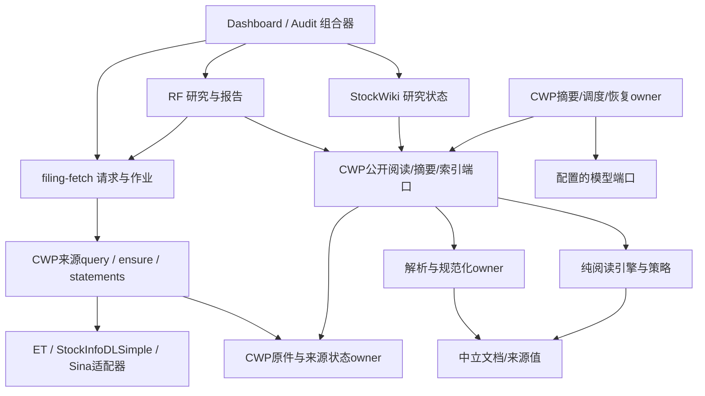

# 架构边界与收口范围

本文件给出目标责任，不把目前代码全部描述为已符合。当前观察见 review/；逐文件清单见 source_inventory.json。CWP 实际 479 个 Python 源文件，CodeGraph 当前索引为 461 个，索引缺项已用磁盘清单补足；关键链深读与全包结构盘点不等于逐行功能审计。

## 当前范围与层次

| 模块 | 唯一职责和自有状态 | 允许消费 | 不应承担 |
|---|---|---|---|
| CWP source_contract / document_model | 来源引用、locator、规范化单元、版本化 wire 值 | 标准库/自身纯值 | 打开DB、解析SDK、网络、运行时配置加载 |
| CWP source_catalog 存储/身份/来源 | 原件登记、来源版本、位置映射、发行人/挂牌/期次、原文字节验真、资料浏览；自有 catalog/原件/manifest | 中立合同、owner 基础设施、采集结果 | 下游研究结论；让消费者用 SQL/物理路径定位来源 |
| CWP acquisition / financial_statements | ensure 编排、下载入库；新浪原始响应与规范化三表版本 | 配置的 provider adapter、来源存储公开操作 | FF 或 RF 自行拼新浪请求/复制归一化/写来源库 |
| CWP parser_adapters / document_normalization | SDK 适配、格式/OCR转换、规范化单元；临时解析状态 | 原文字节/owner staging、显式解析配置和资源预算 | 存储目录发现、投资解释、收费摘要决策 |
| CWP document_understanding | 共享阅读引擎与文种/市场策略；输入单元→观察/选材/定位 | document_model、中立合同、显式策略/预算 | 打开原件/数据库/邻仓、自行下载模型或加载全局配置 |
| CWP narrative / automation | 资料选材到原语言摘要、缓存、工作调度和付费恢复；自有AUTO账与artifact | 来源/解析/阅读端口、显式模型端口和预算 | 从reader对象探测catalog/config；让观察日志决定成功或重发 |
| CWP root support / legacy / CLI | 配置组装、基础文件/进程工具、已声明兼容入口 | 相应公开端口 | 被统一放进无约束 shared 豁免；重新激活旧研究writer/canary |
| filing-fetch | 请求解释、复用优先、公开来源接口调用、作业和传输适配；自有FF job | CWP公开query/ensure/read/statement协议 | 持有CWP连接/SQL、重做身份判定或来源库写入 |
| earnings-transcripts | 电话会采集/抽取/原语言TXT交付，自有provider配置与暂存 | 供应商/网页接口及本模块预算 | 操作CWP库、研究估值；默认要求翻译或外来LLM凭证 |
| StockInfoDLSimple | A股下载/发现provider，自有transport和staging | 官方数据源、typed provider请求 | CWP路径发现、投资分析；吞掉稳定错误码/retryable |
| revenue-forecast | 来源准备适配、证据使用、经营模型、计算、报告/版本/作业；自有研究状态 | FF公开请求、CWP pathless资料、StockWiki公开身份如配置 | SQL读来源库、解析原PDF、根据上游私有目录布局推断成功 |
| StockWiki | 研究主体身份/公司池、业务研究语义和自有DB | CWP规范化文档/来源索引/摘要 | 再解析上游原件或写上游数据库 |
| revenue-forecast-audit | 运行与四路审查、问题和重放记录；自有run目录 | 各模块公开命令、版本化结果/证据 | 注入被审模块内部、把可选观察记录变成任务许可 |
| Dashboard | 页面状态、跨模块组合适配；自有watchlist/job视图 | 各模块公开API/CLI、显式code root与state root | 读取owner私有数据库或内部Python模块 |

ET保留已验证的跨仓CLI，卡内修进程/纯协议依赖；StockWiki、AUDIT优先补组合覆盖，未确认缺陷时不强制修改。Dashboard有既有owner/WIP，保持单作者接续。Sina属于CWP采集/数据owner，PDF/OCR只属于解析owner。Dayu为只读外部依赖；IQS独立owner，采用其公开协议且本轮不改；IR/MeetingConverter/QA-RAG等不在当前活动链时列为外部消费者，不加入无证据重构。

## 目标依赖关系

图表示允许的业务调用方向。各进程的启动、端口绑定和配置读取在其 composition root 完成；合法调用不等于允许导入被调用模块的实现。

## 必须落地的设计原则

1. **协议与能力一致。** 一个消费者只拿到合同声明的值/方法。禁止依赖碰巧存在的 `.catalog`、`.config`、DB连接或模块对象；不通过把私有字段改名public来完成封装。
2. **状态只有一个写入owner。** 原件、来源及披露发行人/挂牌元数据身份在CWP；StockWiki拥有canonical研究主体身份/公司池，各方通过公开DTO关联。研究在RF或StockWiki，job/run各自拥有；Dashboard只持自己的视图/交互状态，不复制canonical公司池。写入日志、可选review不会反向改业务终态。
3. **配置只有入口组装。** 实际配置保持现行语义；纯模块接受必要值或budget对象。默认配置缺失以明确配置错误呈现，不能依赖邻仓目录或测试sys.path才能工作。
4. **低层不依赖高层。** 合同/单元模型可独立加载；读取器可接受两种替代parser/来源端口；数据值不带可变owner对象。独立安装的是现有产品包或skill runtime，不强制把每个小包拆成新仓库/微服务。
5. **中立wire，owner-owned语义。** producer拥有协议，consumer做必要解码及本地领域适配；协议增加可选字段不要求所有仓一起重发版。来源真实性与当前内存同buffer不在每层重复观察；跨新的wire入口仍需必要解析。
6. **兼容有明确位置。** 当前入口和已声明旧版分别测试；废弃工具移出交付默认入口或明确退休。保留历史记录不等于保留可运行的越层入口。
7. **Python封装按语言实际能力设计。** `_`、`__all__`仅是约定；构建/CI拒绝越界依赖，公开facade不暴露内部成员，跨仓进程只收到wire值。普通代码调用未发布API应在边界测试/构建时报错；不新增运行时调用栈鉴权、全局反射拦截、ACL或模拟完整Python解释器。

## 范围锁定

架构关闭只取决于本计划登记的活动入口、依赖边、状态owner和验收场景。摘要召回9/12、公司研究质量、未来业务功能、OCR精度和历史运行产物清理沿父计划继续，不成为本计划的新出口。出现属于本矩阵的真实新绕行归同一owner修复；新产品或独立算法优化另记父计划。
