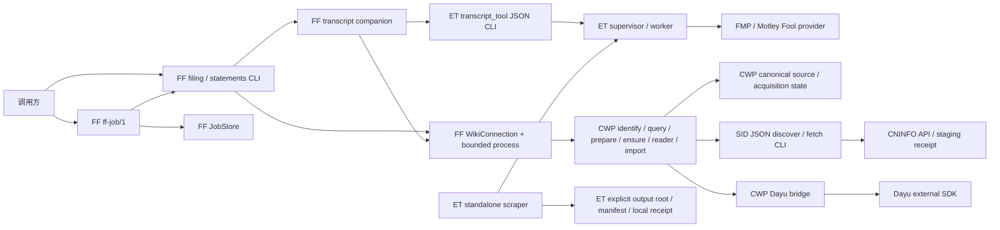

# 采集侧模块边界调查与施工拆分

日期：2026-11-11。范围：filing-fetch（FF）、earnings-transcripts（ET）、StockInfoDLSimple 的 CWP provider 入口及其公开连接。本文是只读规划证据，不是实施完成报告。本轮未运行测试、安装依赖、访问网络、调用收费供应商，也未改动三个被调查仓库。Dayu 仅作为既有外部依赖，禁止改其代码。

阅读说明：第 1—7 节保留独立调查时“优先行为缺陷和隔离证明”的最小施工建议。ROOT 随后依据用户明确要求各模块设计解耦，决定本轮关闭 ACQ-S3/S4 的依赖方向；第 8 节给出该扩围的最小写集合与测试，最终卡数和范围以 ROOT 综合计划为准。

## 1. 基线、调查范围与证据限制

| Owner | 真正 Git 根 | 当前基线 | 本地主线/远端缓存 | 工作树情况 |
|---|---|---|---|---|
| FF | `C:/Users/郑曾波/Projects/filing-fetch` | `f65e6ca75fbce0616e65870f0aea78b793ef883c`，`main`，2026-11-10 | 本地 `main`、缓存 `origin/main` 同 HEAD | ROOT 获准宿主只读 Git 核对：tracked clean |
| ET | `C:/Users/郑曾波/Projects/earnings-transcripts/earnings-transcripts` | `003c1c065109d0b02c7bd4de09ad3e8461a99c0e`，`main`，2026-11-02 | 本地 `main`、缓存 `origin/main` 同 HEAD | ROOT 获准宿主只读 Git 核对：tracked clean |
| SID | `C:/Users/郑曾波/Projects/StockInfoDLSimple/v2-clean-rewrite` | `c0f07e12d4ba3e232d712bb6e5e491832023b0a0`，`v2-clean-rewrite`，2026-10-08 | 本地 `v2-clean-rewrite`、缓存 `origin/v2-clean-rewrite` 同 HEAD；未见 main/master 主线 | ROOT 核对有 11 项 tracked WIP，见下文 |

没有 fetch，不能把缓存远端引用称为“远端最新”。子代理普通沙箱 Git status 遇到 work-tree/cwd 权限错误，以上 dirty 结论使用 ROOT 的获准宿主只读核对；不据此声明所有 untracked 文件为空。

SID 的 11 项现存改动必须保留：`README.md`、`config_template.json`、`main.py`、`src/browser.py`、`src/downloader.py`、`src/logger.py`、`src/mapping.py`、`src/models.py`、`tests/e2e/official_e2e_test.py`、`tests/unit/test_downloader.py`、`tests/unit/test_official_e2e_contract.py`。本报告涉及的 provider 主文件不在这份 tracked WIP 清单内，但 provider 使用的 `logger.py` 有 WIP；未来施工不能从当前工作树整体复制或回滚这些文件。

各实际根及已检查的父目录未发现额外 `AGENTS.md`；遵循本任务明确授权、CWP 的来源职责边界及只读限制。FF 的 `SKILL.md` 作为现行接口说明读取，未启动 filing-fetch 采集工作流。

CodeGraph 先行结果：FF 索引 28 个 Python 文件，但缺少磁盘上现存的大量 `ff_*`、job、transcript 模块，返回的 `fetch_filing.py` 位置也属于旧结构；ET 外层和真实根均返回未初始化；SID 索引位于外层根，列出 `v2-clean-rewrite`，部分当前 provider 新模块未覆盖。没有初始化或更新索引，随后对缺失/旧索引对应文件使用只读源码和 literal import 检查。以下行号均针对已读当前文件；SID WIP 文件仅用来确认依赖，不被认定为本轮可改基线。

## 2. 已实现的运行图与状态归属



### FF：请求编排与自身 job，而不是 provider 或 canonical storage

| 当前模块 | 实际职责与关键依赖 |
|---|---|
| `scripts/ff_job.py`、`ff_job_contracts.py`、`ff_job_store.py`、`ff_job_runner.py` | `ff-job/1` 的 submit/run/status/actions/list、请求幂等键、锁、原子 job 记录、失联转 unknown、成本观察及无重新采集的 reconcile。Runner 调用既有 filing/statements 引擎，不自行实现 provider。|
| `scripts/fetch_filing.py` | 同一文件内仍承担 CLI、身份响应解释、listing/source-market 关联、复用查询、local prepare、ensure、legacy 响应兼容、错误映射、stats 和 companion 装配。`resolve_filing` 从 1255 行开始，`complete_filing_v2` 在 1671 行。|
| `scripts/filing_contracts.py`、`ff_source_ref.py`、`ff_source_candidate.py`、`ff_v2_envelope.py`、`ff_source_failure.py`、`ff_provider_cause.py` | 请求、pathless reference/candidate、结果和具名失败的 FF 消费端契约。不是来源世界事实核验层。|
| `scripts/ff_company_wiki_connection.py`、`ff_configuration.py` | 部署连接解析。支持不透明 `WikiConnection(cwd, commands, acquisition_config)`；仅 legacy `Path` 分支拼 `company_wiki.source_catalog.*`、`config/source_catalog.yaml`、`config/source_acquisition.yaml` 和 `PYTHONPATH=<root>/src`。|
| `scripts/ff_process_transport.py`、`ff_process_tree.py` | 子进程建立、deadline、stdout 业务预算、stderr 排空、进程树回收。结果业务含义由调用端解释。|
| `scripts/ff_local_source_prepare.py`、`ff_local_preparation_observation.py` | 显式复用 miss 后调用 CWP 的本地整理；不扫描公司目录、不自行修来源数据库、不启动 provider。|
| `scripts/transcript_companion.py` | 已有 `TranscriptTransport` Protocol，只有 `lookup_exact`/`acquire_exact`；精确 FY/Q、先复用、最多一次 acquisition、filing 与 transcript 结果独立。|
| `scripts/transcript_tool_transport.py`、`transcript_reuse_selection.py`、`et_v2_contract.py` | 一个 transport 类同时负责 CWP query/open/import、ET 启动与凭证传递、ET usage 消费、原文和 manifest 响应核对；selection 是独立纯逻辑。|
| `scripts/fetch_statements.py`、`ff_financial_statements.py` | 独立的 `financial-statements-request/1`、`financial-statements-response/1` 客户端。经 CWP 公开命令 `company_wiki.source_catalog.financial_statements.cli` 请求历史利润表/资产负债表/现金流量表；新浪 provider、数据获取和规范保存归 CWP `source_catalog/financial_statements` owner。FF 不下载 PDF，也不导入 provider/storage 实现。|

已确认的外部接口：

- filing 原件：CWP `catalog identify`，普通 v2 复用走 `query`；显式 v2 复用 miss 可以调用 `local_prepare` 后再 query。`latest_as_of` 可走有资源限制但无下载许可的 ensure。缺失采集通过单次 `ensure --source-ref-v2` 进入 CWP；producer 返回 gap 后不会由 FF 另发第二次下载。依据：[fetch_filing.py](C:/Users/郑曾波/Projects/filing-fetch/scripts/fetch_filing.py:1095)。
- transcript：CWP query/verified-open；ET `--request-stdin --include-source-payload --report-usage`；CWP `company-wiki-transcript-import-request/2` → `company-wiki-transcript-import-response/3`。只有 CWP 入库成功并返回逻辑 reference，FF 才发布 downloaded。依据：[transcript_tool_transport.py](C:/Users/郑曾波/Projects/filing-fetch/scripts/transcript_tool_transport.py:981)。
- job：FF `.ff_jobs` 是 FF 自身请求和执行账本，不是 CWP 的 acquisition journal/lease/outbox。未知 provider 用量不会当作零，retry 受既有 spend evidence 限制；reconcile 调用 reuse/read 路径。依据：[ff_job_runner.py](C:/Users/郑曾波/Projects/filing-fetch/scripts/ff_job_runner.py:87)、[ff_job_store.py](C:/Users/郑曾波/Projects/filing-fetch/scripts/ff_job_store.py:1)。

### ET：provider 采集、正文保真和可选 standalone 输出

- `transcript_tool.py` 是 JSON/stdin 公共入口，支持 fetch/discover/fetch-candidate、只读 capabilities、stderr usage receipt；凭证源只在启动边界处理，不把 key/path 写入结果。原始 provider payload 与抽取正文有各自 hash 和大小语义。
- `transcript_api.py` 同时定义 wire 常量、provider availability/pricing capability、请求验证、provider 路由、HTTP host/stream/byte 限制、FMP JSON 身份期间绑定及 Motley Fool 发现/抽取。requests、BeautifulSoup、`transcript_extraction` 是运行依赖。FMP 当前精确 US 季度正文抓取受配置/账号实际响应限制；FMP metadata discovery 不由不存在的能力补出来。
- `retrieval_runtime.py` 持有真实操作硬 deadline、worker 生命周期和临时结果回收；`retrieval_worker.py` 负责一次采集，调用 `transcript_api`，只写其私有结果文件。被杀或不可信结果时 usage unknown，不能恢复整份预算再试。
- `retrieval_budget.py` 是 batch/operation 剩余额度与已消耗 HTTP requests/response bytes。跨文档沿用同一 batch 剩余时间/字节/请求数，不能逐文档重置。
- `scraper.py` 是另一个有限批次入口：显式 output root 内的原语言 TXT、receipt、manifest/log/lock；`transcript_artifact.py` 验证本地原件及可选 receipt。默认不构造 translator，只有 `--translate` 显式请求进入翻译。standalone 输出是可登记原件，不是 CWP canonical 目录或研究状态。
- 源码 import 与跨仓字串调查未发现 ET 反向导入 CWP、FF 或 SID；`company-wiki-transcript-adapter/1.0` 仅是 User-Agent。

证据：[transcript_tool.py](C:/Users/郑曾波/Projects/earnings-transcripts/earnings-transcripts/transcript_tool.py:58)、[transcript_api.py](C:/Users/郑曾波/Projects/earnings-transcripts/earnings-transcripts/transcript_api.py:21)、[retrieval_runtime.py](C:/Users/郑曾波/Projects/earnings-transcripts/earnings-transcripts/retrieval_runtime.py:88)、[scraper.py](C:/Users/郑曾波/Projects/earnings-transcripts/earnings-transcripts/scraper.py:1172)。

### SID：无浏览器的 CNINFO provider 与 legacy downloader 并存

- 公共 CWP 入口是 `python -m src.company_wiki_adapter_cli discover|fetch`，不是批量下载 `main.py`。JSON 1.0 成功结果在 stdout，结构化失败在 stderr，fetch 必须指定 staging directory。
- `StockInfoCompanyWikiAdapter` 负责 request/candidate/receipt、公告适配、排除摘要、暂存路径约束；不决定 CWP 的公司 canonical 路径。`CninfoAnnouncementClient` 用官方 API 和 HTTPS PDF transport，`.part` 后原子改名。
- `OrgIdIdentityResolver` 使用请求 org_id → provider 只读本地 cache → official identity lookup；identity、公告分页和 fetch 共享调用方传来的 `ProviderAcquisitionBudget`。provider 返回本次 measured usage，CWP 汇总该 request 的累计剩余额度。
- `ProviderAcquisitionBudget` 只依赖标准库，持 `max_response_bytes`、deadline、费用上限，CNINFO usage 费用为 0；没有第二个跨仓 job 库。
- `main.py`/browser/downloader/progress/mapping 是 legacy standalone downloader，拥有其下载进度和配置输出目录。其 README/template 允许直接指向 CWP companies 属历史部署/手动文件来源；当前 CWP acquisition 配置绑定的是 staging-only adapter，不能用 legacy 默认目录反推 canonical provider 的写入行为。

证据：[company_wiki_adapter_cli.py](C:/Users/郑曾波/Projects/StockInfoDLSimple/v2-clean-rewrite/src/company_wiki_adapter_cli.py:105)、[company_wiki_adapter.py](C:/Users/郑曾波/Projects/StockInfoDLSimple/v2-clean-rewrite/src/company_wiki_adapter.py:487)、[cninfo_identity.py](C:/Users/郑曾波/Projects/StockInfoDLSimple/v2-clean-rewrite/src/cninfo_identity.py:93)、[acquisition_budget.py](C:/Users/郑曾波/Projects/StockInfoDLSimple/v2-clean-rewrite/src/acquisition_budget.py:34)。

### CWP 与 Dayu 的对接归属

现行 [source_acquisition.yaml](C:/Users/郑曾波/Projects/company-wiki/config/source_acquisition.yaml:1) 在部署配置中绑定 CN 的 `StockInfoDLSimple/v2-clean-rewrite` 和 HK/US 的 Dayu runtime；[acquisition_config.py](C:/Users/郑曾波/Projects/company-wiki/src/company_wiki/source_catalog/acquisition_config.py:47) 将 `json_command_v1`/`dayu_sdk_bounded_v1` 组装成 CWP 自己的 command adapter。Dayu 的 venv、SDK 位置和 `tools/dayu_sdk_bridge.py` 是 CWP 部署适配责任，不应搬到 FF 或 ET。Dayu 包不在任何施工写集合中。

CWP transcript import 已显式列出 wire 字段，未直接对外序列化 `SourceRequest`/`DownloadCandidate` 内部 dataclass；内部模型改名不自动改变公开 wire。该良好边界应保留，见 [transcript_import_cli.py](C:/Users/郑曾波/Projects/company-wiki/src/company_wiki/source_catalog/transcript_import_cli.py:1)。

## 3. 已确认缺陷、结构缺口与非缺陷

| ID | 分类 | 当前证据与影响 | 应由谁修 |
|---|---|---|---|
| ACQ-D1 | **当前缺陷，静态调用链可确定，未运行复现** | SID `fetch` 捕获 `CninfoApiError` 后只把 message 传给 `AdapterError`（517 行）；CLI 对失去 typed code/retryable 的 AdapterError 默认 `upstream_unavailable/retryable=true`。底层 `transport_url_host_not_allowed`、`content_too_small`、`pdf_magic_invalid` 原本为 `retryable=false`，其错误类别与可重试性被抹掉。identity/discover 分支已正确传递二者，说明 fetch 不一致。| SID |
| ACQ-S1 | 结构缺口，不声称当前结果错误 | FF filing 主文件混合 CLI/部署/进程/身份/复用/兼容结果；`EarningsTranscriptsTransport` 同时跨 CWP 和 ET 两个边界。已有低层独立模块，但应用编排仍直接拿 command/root/process 细节。未来替换 transport 必须修改业务大文件或 patch 私有函数。| FF |
| ACQ-S2 | 结构缺口，已有良好接缝可利用 | `WikiConnection` 已隔离 legacy CWP 目录；但 ET launch 仍是一个 `.py` 路径+FF 的 `sys.executable`，而不是独立 command descriptor。FF library 的 filing resolve 与 companion complete 分别装配/加载连接，尚非一次注入的 request context。独立安装包需统一 composition root，保留旧路径配置兼容。| FF |
| ACQ-S3 | 结构缺口，不是 CWP 反向调用 | ET supervisor 为常量和 ProviderSettings 导入 `transcript_api`，因而父进程也加载 requests/BeautifulSoup/extraction；worker 再从 supervisor 导入内部协议常量。协议/生命周期与 provider 实现的依赖方向未分离。| ET |
| ACQ-S4 | 结构缺口 | SID `cninfo_api._filter_page/_filter_latest_page` 分别在 773/822 行反向导入 adapter 的私有 `_report_metadata`，adapter 又构造/调用 API client。lazy import 避开导入时错误，但 transport/API 层仍依赖其上层 adapter。应把纯公告类型/期间解析放到 provider domain 模块。| SID |
| ACQ-S5 | 安装/证明缺口 | FF `pyproject.toml` 只有工具配置；ET 当前根未见 pyproject/setup/requirements 发布元数据；SID requirements 强制 Playwright+requests，而 CWP provider 路径本身已有 browserless 测试。当前证明主要是源码目录内运行，不是从三个独立安装包启动。| 各 owner |
| ACQ-T1 | 测试范围缺口 | FF `test_decoupled_connection.py` 覆盖 opaque commands 与缺项无回落，但仅对部分操作 monkeypatch；没有在无 sibling 源码/生产配置的已安装包环境跑完整 filing+companion+job。已存在 frozen ET/CWP goldens，但不能独自证明 producer 新包与 consumer 新包互通。| FF+producer 各自契约测试，ROOT 一次组合 |

ACQ-D1 直接证据：[fetch 包装点](C:/Users/郑曾波/Projects/StockInfoDLSimple/v2-clean-rewrite/src/company_wiki_adapter.py:517)、[CLI 兜底分类](C:/Users/郑曾波/Projects/StockInfoDLSimple/v2-clean-rewrite/src/company_wiki_adapter_cli.py:164)、[底层不可重试 host 错误](C:/Users/郑曾波/Projects/StockInfoDLSimple/v2-clean-rewrite/src/cninfo_api.py:362)。本轮不推断它已经导致真实重复收费或真实生产下载重试。

以下不应重开为“缺陷”：

- `company_wiki_root` legacy 配置中可见目录，不等于 v2 source result 泄漏；现在已经有 `WikiConnection` 和 pathless projection。路径应继续仅属于部署适配层，不应要求用户改每份材料授权。
- FF 没有直接导入 CWP 的数据库/存储/provider 代码；ET、SID 未发现向 CWP 回写内部数据库的实现依赖。跨仓通信是 subprocess/public wire。
- CWP bytes/身份/期间的 owner 验证，FF 对跨进程收到的 reference/receipt 的绑定核对，不能一概视作“多余重复校验”删除。真正应消除的是同层对同一已验证不可变值的重复解释，不是放松公开输入边界。
- CWP、FF job、ET batch 各有自己范围的状态和预算是合理分层；不能为了统一框架另建公共任务库或统一许可服务。已有未知消耗、被中断、optional receipt 语义必须保留。
- 结构拆分不得把摘要/receipt 行数、证据条数、模块行数等诊断阈值变成任务许可；真实请求的资源上限继续执行。

## 4. 可独立交付的边界与条件性拆包方案

当前三个仓库已经能作为独立 CLI/skill 交付单元。建议先以隔离契约测试证明现有边界；测试通过可以 NO_CHANGE，不为了“模块化”强制改目录、改成 wheel 或建立新框架。下表是确有隔离失败或后续发布需求时的依赖方向，不是本轮全部实施任务；尤其 ET 暂不设实现卡，只进入 ROOT 组合验证。

| 包 | 建议内部边界 | 最小运行依赖 | 禁止依赖 |
|---|---|---|---|
| `filing-fetch` | `contracts`（request/reference/error/job wire）；`application`（filing/companion/statements 业务）；`ports`（CWP operations、TranscriptProvider）；`adapters`（command transport、CWP legacy layout、ET launch）；`jobs`（FF owner store/runner）；`cli`（现有脚本薄包装） | 当前运行模块基本为标准库；通过配置启动 CWP/ET 公开命令 | CWP Python implementation、ET provider Python implementation、SID、Dayu SDK、源数据库或 canonical 文件目录 |
| `earnings-transcripts` | `contracts`+`settings`（无 HTTP/parser import）；`providers/fmp`、`providers/motley_fool`；`http`；`extraction`；`supervisor/worker_protocol/worker`；`artifact/batch`；可选 translation facade | provider 使用 requests、beautifulsoup4；standalone YAML 配置需要 PyYAML；翻译依赖仅显式 translation 路径加载 | CWP/FF import、canonical registry、投资研究 state |
| SID 内 `cninfo-provider` | `contracts`；`report_metadata` 纯解析；`identity`；`http`；`budget`；`staging`；`cli` | CWP provider 路径可保持标准库；legacy browser downloader 留在原 SID 项目 | CWP/FF import、browser/downloader/progress/mapping 运行态、Dayu |

FF `TranscriptTransport` 和 SID `OrgIdResolver` 继续沿用，不重建同义 Protocol。CWP 的公开 request/response schema 继续由 CWP owner 维护，ET content/capability/usage schema 由 ET owner 维护，SID candidate/receipt/budget schema 由 SID owner 维护。各消费者保存协议快照和 producer fixture，可以分别验证；不要把可执行 owner 实现复制到“共享 contracts”仓库。

FF 的 CWP catalog、query、local_prepare、open、transcript_import、financial_statements 六个 operation 继续作为连接 descriptor 的有限全集。如测试证明 ET launch 必须支持独立解释器，再考虑 command descriptor；这只扩展部署位置表达，不增加 request 中可执行任意命令的字段，旧 `earnings_transcripts_tool` 配置保持兼容。新包入口可用 `python -m ...`，但当前脚本入口独立性已成立时不强制替换。

SID standalone browser 功能与 provider 的拆分要从已固定基线/owner WIP 约定处施工，不把 11 个现存 WIP 塞进 provider 包。`src/logger.py`、constants、config 的 provider 所需最小功能可以形成独立标准库模块；不要为这一步顺带重构 legacy main/downloader。

## 5. Owner 写集合与 TDD 施工顺序

采集侧推荐 **2 张施工卡**：FF 的明确隔离/契约验证卡（允许 NO_CHANGE），SID 的已证实错误契约修复卡。ET 不独立施工。与 ROOT 的 CWP/RF 卡组合时是 **4 张实现/验证卡**，另有一个 ROOT 组合验证节点。本轮只写本报告。每个 owner 在自己的隔离 checkout/branch 上做 RED→GREEN→必要整理，不以“卡存在”为必须重构的理由，不增加小节点许可。

| 施工包 | 准确 owner 与允许写集合 | 不写集合/依赖 |
|---|---|---|
| FF：公共 operation 隔离与 consumer 契约 | 测试默认写集合：`tests/test_decoupled_connection.py`；新增 `tests/test_public_operation_isolation.py`、`tests/fixtures/public_operation_isolation/**`；`tests/financial_statements/test_fetch_statements_subprocess.py`、`tests/financial_statements/test_layer_boundary.py`；必要时仅将新增测试纳入 `tools/ci_tests.py`。若 RED 证明当前运行失配，最小修复候选只限 `scripts/ff_company_wiki_connection.py`、`ff_configuration.py`、`fetch_filing.py`、`ff_financial_statements.py`、`transcript_tool_transport.py` 中对应边界；其它修改须有新失败证据并由 ROOT 调整写集合。 | 既有测试已覆盖且全部通过时可 NO_CHANGE。禁止为此新建框架、整体搬迁 scripts、改 job store、强制 wheel；不写生产 `config/company_wiki.json`、凭证、CWP/ET/SID/Dayu、全局 skill 部署。|
| SID：ACQ-D1 typed failure 修复 | 在 `c0f07e1` 的独立 clean worktree：`src/company_wiki_adapter.py`；若契约测试明确需要才改 `src/company_wiki_adapter_cli.py`；新增 `tests/unit/test_provider_error_contract.py`，可补 `tests/unit/test_company_wiki_adapter.py`、`tests/unit/test_company_wiki_adapter_cli_budget.py`。先 RED host/magic/too-small/timeout 的 code/retryable/usage，再最小修复。 | 不改当前主工作树的 11 项 WIP，不将 `_report_metadata` 移动或 provider 打包列为当前必做项；已读 API 架构问题是后续候选，不影响本卡有限结束。|
| ET：ROOT 组合验证输入 | ET 无源码写集合。ROOT 使用固定 `003c1c0` artifact 与已存在 offline fixtures/launcher，通过公开 ET CLI 覆盖 success、wrong period、credentials missing、usage unknown、deadline、raw payload 导入。组合运行证据只写 ROOT 测试实例。 | 不强造 ET 实现卡，不因文件较大重新拆 provider，不更改翻译、账号配置、provider enablement 或真实 transcripts。若组合验证出现新缺陷，再形成具名 RED 与精确 owner 修复。|
| CWP 组合适配 | CWP owner 独立拥有公开 CLI、command adapter、provider 配置示例和 producer/consumer contract fixture；以根计划给出的确切写集合为准 | FF/ET/SID 包不写 CWP。若旧 CLI wire 保持，CWP 运行实现不必为“模块化”同步重写。真实生产配置切换属于最终部署步骤，不是每次单测副作用。|

FF 当前运行文件清单（调查清单，不是批量修改授权）：`et_v2_contract.py`、`fetch_filing.py`、`fetch_statements.py`、`ff_company_wiki_connection.py`、`ff_configuration.py`、`ff_financial_statements.py`、`ff_job_contracts.py`、`ff_job_runner.py`、`ff_job_store.py`、`ff_job.py`、`ff_local_preparation_observation.py`、`ff_local_source_prepare.py`、`ff_process_transport.py`、`ff_process_tree.py`、`ff_provider_cause.py`、`ff_source_candidate.py`、`ff_source_failure.py`、`ff_source_ref.py`、`ff_v2_envelope.py`、`filing_contracts.py`、`transcript_companion.py`、`transcript_reuse_selection.py`、`transcript_tool_transport.py`。

## 6. 已有测试与新增证明候选

已有测试名称仅表示源码中存在，本轮没有执行，因此不声明通过。下表是可选证明库；本轮默认只实施 FF operation 隔离和 SID ACQ-D1 两组，ET/包内结构项仅在 ROOT 组合或后续真实发布需求出现时启用，不全部生成测试卡。

| Owner/关切 | 已有可复用测试 | 新增 RED 用例（建议名称） |
|---|---|---|
| FF 独立连接 | `test_decoupled_connection.py::test_external_connection_has_no_catalog_layout_requirement`、`test_missing_operation_never_falls_back_to_an_unconfigured_producer`、`test_transcript_and_statements_use_same_connection` | `test_installed_ff_all_operations_use_only_configured_commands`：移除 sibling roots，空 cwd，清空继承 PYTHONPATH，只给 fixture command，六个 operation 均成功；缺项具名失败无猜路径。|
| FF pathless/复用 | `test_source_ref_v2_db_query.py::test_reuse_queries_db_only_without_resolve_or_source_bytes`、`test_cross_market_request_keeps_listing_and_source_identity_separate`、`test_operation_v2_rejects_drift_and_path_leaks` | `test_packaged_ff_reuse_is_provider_free_and_pathless`：公开 CLI → fake public CWP，验证 reuse-only 不触发 provider，issuer/source scope 保留，递归路径泄漏仍拒绝。|
| FF job | `test_ff_job_facade.py::test_second_run_is_idempotent_noop`、`test_ensure_receipt_loss_never_proves_zero_spend`、`test_unknown_only_allows_reconcile_and_run_refused`；`test_ff_job_cross_process.py::test_live_run_cannot_lose_its_lock_to_a_second_process` | `test_installed_job_reconcile_uses_query_port_without_reacquisition`：独立进程中断后 unknown→reconcile；只消费 owner 查询，不自动重新 paid dispatch。|
| FF ET 与 usage | `test_transcript_companion_transport.py::test_fmp_tool_result_is_imported_and_verified_through_cwp`、`test_absent_or_invalid_usage_is_unknown_not_an_invented_http_count`；`test_transcript_owner_budget.py::test_explicit_resources_reach_the_et_owner` | `test_et_command_descriptor_uses_configured_interpreter_and_cwd`；`test_import_failure_preserves_provider_usage_in_packaged_chain`；`test_one_request_reuses_one_connection_snapshot`。|
| FF 合同快照/进程 | `test_et_s0b_contract.py`、`test_cwp_s0b_source_ref_contract.py`；`test_p5_process_transport.py` deadline/pipe/grandchild；`test_p5_process_lifecycle.py` | `test_domain_import_never_loads_adapters_or_external_repos`；新包与旧 wrapper 对同 fixture 的公开响应/exit 相同；stderr 可选大诊断不改变合法 stdout 业务结果。|
| ET supervisor/usage | `test_retrieval_runtime.py::test_worker_crash_is_failure_with_unknown_usage`、`test_second_operation_shares_the_original_deadline`；`test_retrieval_cli_e2e.py::test_tool_blocked_worker_is_killed_at_the_request_deadline`、`test_two_document_batch_second_gets_only_remaining_budget` | `test_contract_and_supervisor_import_without_http_or_parser_modules`；`test_installed_worker_resolves_without_checkout_or_tests_package`；在已安装包上通过测试 adapter 驱动同一 public CLI，崩溃/超时/晚结果保持 unknown。|
| ET provider/预算/凭证 | `test_provider_cost_capability.py::test_capabilities_cli_is_local_and_does_not_read_request_or_key`；`test_launch_capability_contract.py::test_explicit_key_file_reaches_supervised_worker_with_no_serialized_secret`；`test_request_response_budget.py::test_worker_response_quota_is_effective_when_request_quota_is_none` | `test_packaged_capabilities_are_local_without_provider_import`；`test_provider_contract_fixture_covers_success_gap_wrong_period_unknown_usage`。不能以 capability 代替账号 entitlement。|
| ET 本地输出 | `test_batch_runtime.py::test_output_writes_are_isolated_under_output_flag`、`test_default_run_never_translates_or_constructs_translator`、`test_existing_fmp_original_is_reused_without_credentials_or_http`；`test_optional_local_receipt.py::test_optional_bad_sidecar_downgrades_but_preserves_proven_local_original` | `test_installed_batch_writes_only_explicit_output_root`；`test_acquisition_import_does_not_load_translation_facade`；原始 TXT/hash/期间/语种和 optional receipt 兼容回归。|
| SID 纯 provider | `test_g5_provider_runtime.py::test_provider_modules_import_without_browser_or_downloader`、`test_build_adapter_is_pure_api_and_writes_no_failure_log`、`test_official_identity_and_announcements_share_one_budget`、`test_fetch_is_pure_and_never_touches_identity_or_downloader` | `test_installed_cninfo_provider_without_playwright_or_sibling_checkout`；`test_cninfo_api_does_not_import_adapter_module`，过滤结果与迁移前 golden 一致。|
| SID 当前错误缺陷 | `test_company_wiki_adapter.py::test_fetch_rejects_non_cninfo_transport_host`、`test_fetch_rejects_non_pdf_payload` 只证明拒绝；现有 identity typed failure 测试不覆盖 fetch 的丢失 | `test_fetch_cli_preserves_nonretryable_provider_error`：host/magic/too-small 参数化，CLI code 与 retryable 与底层一致；`test_fetch_cli_preserves_retryable_timeout_and_usage`：保留 timeout 的 typed cause 与已计响应字节。|
| SID staging/预算 | `test_company_wiki_adapter.py::test_fetch_writes_only_allocated_staging_and_returns_hash_receipt`；`test_cninfo_api_budget.py::test_bounded_pdf_stream_over_limit_removes_partial_file`；`test_company_wiki_adapter_cli_budget.py::test_cli_budgeted_failure_preserves_partial_usage_and_is_not_retryable` | 已安装包真实子进程，以本地假 transport/recorded bytes 测试 stdout/stderr wire、path containment、共享剩余额度，确认不创建 canonical/company/progress 文件。|

### 可执行隔离方式与命令

实施时先在各 owner 隔离 checkout 内运行下列已有测试，作为行为基线；命令不接触生产配置或 live provider，本轮未执行。使用仓库既定 Python 环境。测试 scratch 必须为该 owner 的新临时目录，不复用 `.source_catalog`、`.ff_jobs`、生产公司目录或真实 ET output。

```powershell
# FF checkout
python -B -m pytest tests/test_decoupled_connection.py tests/test_source_ref_v2_db_query.py tests/test_ff_job_facade.py tests/test_ff_job_cross_process.py tests/test_transcript_companion_transport.py tests/test_transcript_owner_budget.py tests/test_failure_usage_continuity.py tests/test_et_s0b_contract.py tests/test_cwp_s0b_source_ref_contract.py tests/financial_statements/test_fetch_statements.py tests/financial_statements/test_fetch_statements_subprocess.py tests/financial_statements/test_layer_boundary.py -q -p no:cacheprovider

# ET checkout
python -B -m pytest tests/test_retrieval_runtime.py tests/test_retrieval_cli_e2e.py tests/test_launch_capability_contract.py tests/test_provider_cost_capability.py tests/test_request_response_budget.py tests/test_batch_runtime.py tests/test_optional_local_receipt.py -q -p no:cacheprovider

# SID checkout
python -B -m pytest tests/unit/test_company_wiki_adapter.py tests/unit/test_company_wiki_adapter_cli.py tests/unit/test_company_wiki_adapter_cli_budget.py tests/unit/test_cninfo_api_budget.py tests/unit/test_g5_provider_runtime.py -q -p no:cacheprovider
```

FF 新 `tests/test_public_operation_isolation.py` 在 tmp 中布置当前规范的 skill/runtime artifact，不要求先改 wheel：真实 subprocess 启动当前 filing/statements/job 入口，CWP/ET 指向 fixture public commands。子进程 cwd 是空临时目录；环境移除跨仓 `PYTHONPATH`、Git 仓库上下文和真实 credentials；测试 import guard 拒绝 sibling implementation，socket/HTTP 边界只允许 fixture transport。覆盖普通 query hit、query miss→local prepare→query、single ensure、transcript query/open/import、statements complete/partial/具名失败、job reuse/reconcile。确认 six operations 都从 `WikiConnection` 走，并保留各自 wire/exit/usage；不只 monkeypatch 当前进程私有方法。新增用例完成后命令为 `python -B -m pytest tests/test_public_operation_isolation.py -q -p no:cacheprovider`。如果已有测试已经完整证明相同边界，无需复制测试，可记录 NO_CHANGE。

若后续确实选择 wheel 发布，再由安装测试创建 tmp venv/wheel 目录，用预置本地 wheelhouse 离线构建/安装（`--no-index`）；当前任务不以新增 packaging metadata 为完成条件。

生产入口不新增测试专用 `--unsafe`/任意 launcher 环境后门；ET 现有私有 launcher seam 可由 ROOT 测试适配程序使用，生产 worker 不依赖 `tests.*`。producer fixtures 由各自固定公开入口输出，consumer 只读取 fixture/wire；完整 bytes/响应落盘，报告仅索引，不静默剪短证据。

FF `tools/ci_tests.py` 已区分完整 consumer CI 与固定本地 smoke；跨仓 frozen-CWP matrix 另属集成节点。未来把新增边界/安装测试接入相应 CI，并保留完整现有 CI；不用每次微小移动都重复全套真实跨仓端到端或付费链。

## 7. 依赖顺序与有限完成定义

1. **合同基线与 RED**：各 owner 固定上述 HEAD/WIP，保留现有 schema、fixture 和退出码。SID 首先加入 ACQ-D1 的失败用例；FF核对已有测试并补未覆盖 operation 的独立 subprocess 证明。先验证测试确实覆盖破坏边界的情况，不写只镜像实现的断言。
2. **独立 owner 实施**：FF 仅修复隔离测试揭示的问题，可以 NO_CHANGE；SID 最小修复 typed error；ET保持固定输入。CWP/RF 由 ROOT 的独立卡负责。不要求其它 owner 同日切换源码目录，不为了框架整齐搬动正常模块。
3. **owner 完整 CI 与契约**：现有必要 CI、新增隔离测试和 producer/consumer contract 全通过；记录实际测试命令、artifact hash 和失败修复。并非按代码行数或测试数量达标。
4. **一个组合节点**：ROOT 用三个固定 artifact 加 CWP 测试实例，零网络/零付费验证 reuse、bounded fetch fake provider、ET→CWP import、错误和未知用量、FF job crash/reconcile。到此做用户指定的大节点独立质量审查；不扩展为每小节点人工审批。
5. **完成即停止**：FF 六类公开 operation（含新浪三表客户端）在独立 fixture 连接下无 sibling implementation import；ET 固定 CLI 经组合验证；SID provider 保持不加载 browser 且 ACQ-D1 typed error 丢失被修复；旧入口可兼容；来源/预算/unknown/optional-diagnostic 语义无回退；所有生产配置和现存 WIP可解释且未被测试写穿。部署配置切换、全局技能同步、真实下载或收费回放不由“模块化完成”隐式触发。

不属于本轮有限目标：新建 universal workflow 引擎、统一四仓数据库、重写 Dayu、迁移历史原件、扩展未知供应商、建立研究 accepted/rejected 状态、投资估值/评级、无限常驻任务。未来真实 provider 验收若需要，作为一个有明确 acquisition intent 与累计资源预算的独立验证节点，沿用现有授权，不新建逐文档人工门禁。

## 8. ROOT 范围补充：本轮关闭 ET/SID 依赖方向

ROOT 采纳 ACQ-S3/S4 作为用户本轮模块化要求内的已确认设计问题：ET 新增单仓实现卡；SID 同卡同时修 ACQ-D1 并关闭 API→adapter 反向依赖。这样采集侧为 **FF/ET/SID 三卡**，与 CWP/RF 合计 **五张实现/验证卡**，仍只有一个 ROOT 大组合节点。FF 仍可 NO_CHANGE；ET 和 SID 不进行第 4 节的整包重写，不新增 provider。

### ET 最小单仓卡

真实根：`C:/Users/郑曾波/Projects/earnings-transcripts/earnings-transcripts`，从 `003c1c0` 独立 checkout 施工。

准确生产写集合：

- 新 `transcript_contracts.py`：现有公共 request/result/discovery/candidate schema 字符串及其请求默认额度等纯契约值；只依赖标准库，不导入 provider/HTTP/parser/supervisor。额度仍是现有默认/显式请求语义，不成为第二套结果许可。
- 新 `transcript_provider_settings.py`：`ProviderSettings`、`DEFAULT_PROVIDER_SETTINGS`、现有纯函数 `provider_operation_capability` 和其 exchange 常量。保持 disabled/未知 entitlement/零增量费等现行值，不引入账号探测或新 provider。
- 新 `retrieval_protocol.py`：内部 `WORKER_PROTOCOL`、request/result 文件名、worker envelope 的纯字段/校验/编码额度计算；父 supervisor 与子 worker 都依赖这个模块。它不导入 `retrieval_runtime` 或 `transcript_api`。
- 修改 `transcript_api.py`：从纯模块导入，保留旧公开名字的兼容 re-export；保留现有 HTTP/身份/期间/抽取/provider 行为。
- 修改 `retrieval_runtime.py`：常量/settings/protocol 从纯模块导入，不因启动或检查 worker 协议而加载 requests、BeautifulSoup、extraction。
- 修改 `retrieval_worker.py`：内部 envelope 定义从 `retrieval_protocol` 取得，不反向 import supervisor；worker 执行采集时继续使用 `transcript_api`，不以 worker 的 provider 依赖冒充父进程依赖。
- 修改 `transcript_tool.py`：契约/settings/capability 用纯模块；provider 操作函数仅在确需 preflight/fetch/discover 路径装配，`--capabilities` 保持本地操作。保留原 CLI 参数、stdout/stderr/退出码。

准确测试写集合：新增 `tests/test_runtime_module_boundaries.py`、`tests/test_worker_protocol_contract.py`；如迁移改变测试导入位置，仅修改 `tests/test_retrieval_runtime.py`、`tests/test_retrieval_cli_e2e.py`、`tests/test_provider_cost_capability.py`、`tests/test_request_response_budget.py`、`tests/test_launch_capability_contract.py` 中与该边界有关的断言/fixtures。无需改 `scraper.py`、原件/翻译模块、用户 config/key/transcripts；新模块必须随现行独立运行 artifact 同行，不强制改 wheel 发布。

新增 RED 的可执行证明：

1. `test_supervisor_import_does_not_load_provider_http_or_parser`：新 Python 进程安装 import guard，拒绝 `transcript_api`、`transcript_extraction`、`requests`、`bs4`；导入 `retrieval_runtime` 并执行纯 result envelope 校验。当前会失败，改后通过。
2. `test_worker_protocol_does_not_import_supervisor`：拒绝 `retrieval_runtime` 的进程中验证 worker 协议/纯值，再执行 worker offline fixture dispatch；允许 worker 自己的 provider 执行依赖。
3. `test_capabilities_cli_is_provider_import_free`：guard 拒绝 provider/HTTP/parser，公开 `--capabilities` 输出与当前 golden 相同，零 key 读取、零 HTTP、零写入。
4. `test_old_public_contract_imports_preserve_values_and_settings_identity`：既有消费者仍从 `transcript_api` 导入常量/settings，验证新旧入口对象一致、wire 不变，不复制第二份定义。
5. `test_protocol_refactor_preserves_request_id_schema_usage_and_deadline`：复用既有 supervised success/crash/wrong-id/late-result fixtures，通过真实 worker，保留 unknown usage、deadline、清理错误和 raw payload hash。

```powershell
python -B -m pytest tests/test_runtime_module_boundaries.py tests/test_worker_protocol_contract.py tests/test_retrieval_runtime.py tests/test_retrieval_cli_e2e.py tests/test_provider_cost_capability.py tests/test_request_response_budget.py tests/test_launch_capability_contract.py -q -p no:cacheprovider
```

补充静态发现：`retrieval_worker.py:183` 仍有 `if len(data) > MAX_RESULT_BYTES: return 2`，而 `retrieval_runtime.py:51` 的旧常量约为 146 MiB；父进程 `_result_read_limit` 已按实际 operation quota 派生。显式响应额度更大、base64 信封超过旧常量时，worker 可能把合法 owner 结果变成 worker failure。这是新增的固定表示门风险，**尚未运行复现**。ET owner 应以低内存合成 fixture/测试缩小旧常量的方式先做 `test_worker_result_has_no_fixed_legacy_representation_veto`，再决定同卡最小修复；不要仅把该固定 veto 搬入新纯协议并宣称预算语义已完整保留。真实 I/O/编码失败及请求 resource budget 仍须区分并保留。

### SID 同卡增加纯公告解析模块

真实根：`C:/Users/郑曾波/Projects/StockInfoDLSimple/v2-clean-rewrite`，基于 `c0f07e1` 新 clean worktree，不改变当前 11 项 WIP。

在第 5 节 SID 写集合上，最小增加：

- 新 `src/cninfo_report_metadata.py`：迁移现有 `_YEAR_RE` 和 `_report_metadata` 的纯 title→kind/year/form/period/amended 解析，公开内部函数可命名 `report_metadata`。不加入新的日期/季度猜测规则。
- `src/company_wiki_adapter.py`：导入此纯函数；必要时保留 `_report_metadata` 兼容 alias；同一文件修复 fetch typed error。摘要排除仍由 adapter 负责，不移动到 API 解析。
- `src/cninfo_api.py`：`_filter_page` 和 `_filter_latest_page` 改为直接导入纯模块，不再从 `company_wiki_adapter` 私有函数取规则。
- 新 `tests/unit/test_cninfo_report_metadata.py`、`tests/unit/test_provider_module_boundaries.py`；必要现有回归文件 `tests/unit/test_cninfo_api.py`、`tests/unit/test_cninfo_api_fixture_contract.py`、`tests/unit/test_company_wiki_adapter.py`。其它测试按第 5 节维持。

新增 RED：

1. `test_cninfo_api_filtering_runs_when_adapter_import_is_forbidden`：guard 禁止 `src.company_wiki_adapter`，真实 `CninfoAnnouncementClient` 消费已记录公告 JSON，exact/latest 两条过滤都能返回原有结果；当前在两处 lazy import 失败。
2. `test_report_metadata_import_is_standard_library_only`：禁止 browser/downloader/adapter/API 导入，独立调用纯解析；不把 AST 文本样式作为唯一证明。
3. `test_frozen_announcements_preserve_exact_and_latest_period_metadata`：同一份 fixture 上检验 FY/H1/Q1/Q3、修订、空白、未知年份等当前输出；摘要仍在 adapter 层被排除，API 的历史语义不改。
4. `test_adapter_legacy_metadata_alias_matches_pure_parser`：若保留旧私有入口，证明它只是同一实现 alias；不在两个文件维持两份解析代码。
5. 保留 ACQ-D1 的 host/magic/too-small/timeout CLI error/usage 测试，避免结构迁移遮住实际缺陷。

```powershell
python -B -m pytest tests/unit/test_cninfo_report_metadata.py tests/unit/test_provider_module_boundaries.py tests/unit/test_provider_error_contract.py tests/unit/test_cninfo_api.py tests/unit/test_cninfo_api_fixture_contract.py tests/unit/test_cninfo_api_budget.py tests/unit/test_company_wiki_adapter.py tests/unit/test_company_wiki_adapter_cli.py tests/unit/test_company_wiki_adapter_cli_budget.py tests/unit/test_g5_provider_runtime.py -q -p no:cacheprovider
```

ET/SID 的新增纯模块和运行 import 方向通过、原有公开 wire/预算/来源行为回归通过，就是这次扩围的结束条件。不要求拆出 provider 插件系统、重写旧 browser 或发布新仓库。大节点独审与完整 CI仍按 ROOT 计划执行。
